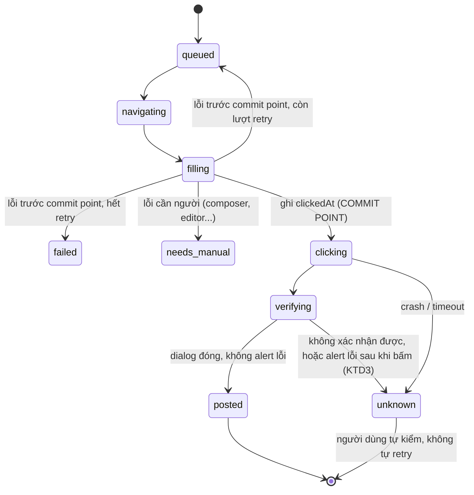
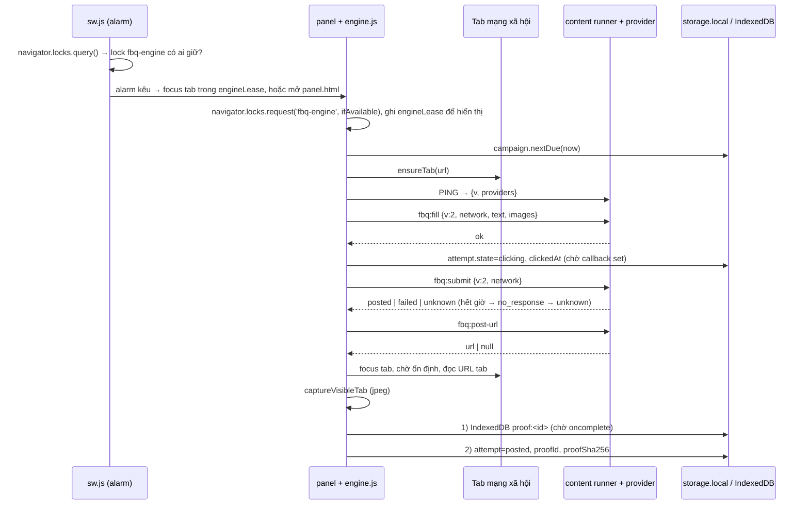
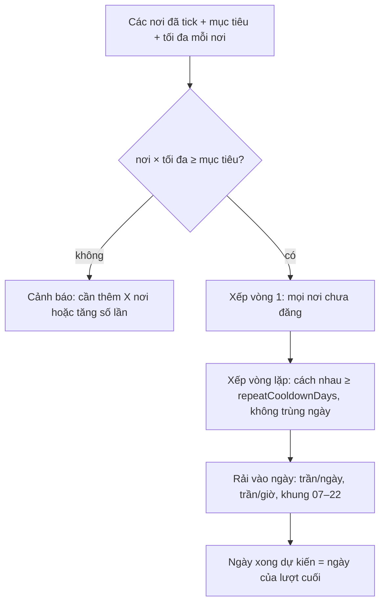

# Đăng bài đa kênh + Nghiệm thu - Plan

## Goal Capsule

- **Outcome:** Sales/marketer tick các nơi đăng (FB Group, FB timeline, nhóm Zalo; từ P4 thêm tường TikTok, Instagram, X), bấm một lần, tool tự đăng chậm và rải qua nhiều ngày cho đủ số lượt nghiệm thu. Xong thì xuất một file `.zip` có ảnh chụp và link bài (nếu có) để bộ phận check duyệt.
- **Cổng đầu tiên (P0):** nút **Đăng** phải bấm được thật. Chưa qua cổng này thì không làm P1–P4.
- **Cổng cuối (P4):** một batch 20–30 bài thật trên năm mạng, trong trần an toàn và ngân sách KTD21, có đủ trong zip.
- **Không được vi phạm:**
  - Không retry sau khi đã bấm Đăng.
  - Không tạo bằng chứng giả.
  - Không thêm quyền `cookies`, `webRequest`, `debugger`, `<all_urls>`.
  - Không cho nâng trần vượt preset an toàn.
- **Kiểm chứng:**
  - `node --test test/*.js` xanh sau mỗi unit.
  - Mỗi pha kết thúc bằng một lần chạy thật trên tài khoản test.

---

## Product Contract

### Summary

Nâng cấp extension MV3 hiện có, không thêm server. Thứ tự làm: sửa đường đăng FB và thêm commit point chống đăng trùng (P0), rồi chụp bằng chứng và xuất zip nghiệm thu (P1). Sau đó gom nơi đăng về một mô hình chung và thêm Zalo Web (P2), tiếp theo là bộ lập lịch chiến dịch nhiều ngày với trần theo hạng tài khoản và khoá leo thang (P3). Cuối cùng thêm TikTok, Instagram và X bằng DOM trong phiên của người dùng, cùng một lần bấm cho mọi mạng (P4). Giao diện panel được làm lại ở U12 để sale không rành kỹ thuật vẫn dùng được. Lý do không dùng công cụ omni-channel mã nguồn mở nằm ở `docs/discovery/06-vi-sao-khong-dung-opensource.md`.

### Problem Frame

Một content phải được đăng khoảng 50 lần thì người làm mới được nghiệm thu và nhận lương. Hiện họ mở từng group, dán bài, bấm Đăng, rồi tự chụp màn hình và gom link. Extension hiện tại đã chèn được chữ và ảnh vào composer của Facebook nhưng chưa bấm được nút Đăng, chưa có bằng chứng, chưa có Zalo và chưa biết rải lịch qua nhiều ngày.

Đăng cùng một nội dung 50 lần nằm đúng vùng rủi ro mà chính sách spam của Meta nhắm tới (tần suất cao cộng nội dung lặp). Vì vậy tốc độ là ràng buộc sản phẩm, không phải tham số tinh chỉnh. Tool phải chậm, rải nhiều ngày, và tự dừng khi nền tảng phát tín hiệu. Người dùng đăng bằng tài khoản thật họ đang dùng để làm việc, nên khoá tài khoản là thiệt hại trực tiếp cho họ.

Đọc code ngày 2026-11-10 còn thấy thêm các lỗi chặn mục tiêu, ngoài lỗi nút Đăng:

- **A.** Bài chỉ có chữ luôn hỏng: `baseThumbs` không được gán khi không có ảnh (`src/content/adapter-group.js:140`, `:178`).
- **B.** Bộ ngắt khi lỗi liên tiếp không bao giờ kích hoạt (`src/ui/engine.js:277` so với `:364`).
- **C.** `targetMode` được ghi mà không ai đọc (`src/ui/panel.js:457`).
- **D.** Khi Facebook báo giới hạn, lượt đang chạy bị kẹt ở trạng thái `countdown` và bị bỏ qua khi chạy tiếp (`src/ui/engine.js:312–314`).
- **F.** Ô chọn ảnh trên panel (`src/ui/panel.html:23`) chưa nối vào đâu. Chỉ có `popup.js` gọi `putAsset`, nhưng popup không được mở.

### Requirements

| ID | Yêu cầu | Nguồn |
|---|---|---|
| R1 | Nút Đăng hoạt động thật trên FB Group và FB timeline. Một bài thật lên group test có trạng thái `posted` | G1 |
| R2 | Một danh sách "Nơi đăng" chung cho `fb_group`, `fb_timeline`, `zalo_group`, lọc được theo mạng. `network` là chuỗi mở để thêm mạng sau | G2, 8.2 |
| R3 | Quét nơi đăng theo từng mạng: bấm "Quét" thì danh sách tự đầy. Quét ra 0 nơi thì hiện trạng thái rỗng có hướng dẫn | G3 |
| R4 | Chiến dịch gồm 1 content, N nơi đăng và một mục tiêu số lượt. Tool tự rải lịch qua nhiều ngày trong trần an toàn và hiện ngày dự kiến xong | G4, 8.5 |
| R5 | Mỗi lượt `posted` lưu: link bài (nếu có), ảnh chụp, giờ đăng, tên và link nơi đăng, tài khoản | G5, 8.6 |
| R6 | Xuất `nghiem-thu-<tài khoản>-<ngày>.zip` gồm `nghiem-thu.csv` (UTF-8 có BOM), `nghiem-thu.html` (mở offline, có ảnh thu nhỏ và link bấm được) và thư mục `anh/`. Cột CSV: STT, tài khoản, mạng, tên nơi đăng, link nơi đăng, link bài, giờ đăng, file ảnh, trạng thái | G6, 8.6 |
| R7 | Nội dung gồm chữ, hashtag, ảnh/video. Không gắn cứng BĐS ở bất kỳ đâu trong code hay UI. TikTok: nếu bản web không cho đăng bài ảnh (spike U16), TikTok chỉ nhận video và UI báo trước khi người dùng tick | G7, KD9 |
| R8 | Máy trạng thái có commit point: ghi `clickedAt` trước khi bấm. Sau commit point không bao giờ tự retry. Không chắc kết quả thì ghi `unknown` | 8.4 |
| R9 | `posted` không có `postUrl` vẫn hợp lệ nếu có ảnh chụp | 8.4, quyết định 7 |
| R10 | Nút điều chỉnh của chiến dịch: mục tiêu số lượt; tối đa mỗi nơi 1–5, mặc định 1, kèm cảnh báo "cần chọn thêm X nơi hoặc tăng số lần mỗi nơi"; khoảng cách lặp mặc định 3 ngày, sàn 1 ngày. Không bao giờ đăng cùng một nơi hai lần trong một ngày. Nơi chưa đăng được ưu tiên. Ngày xong dự kiến cập nhật ngay khi đổi nút | 8.5 |
| R11 | Trần theo hạng tài khoản: T0 5/ngày 2/giờ, T1 12/4, T2 20/6, T3 30/8. Mặc định T1, người dùng chọn. Zalo: 10/ngày, 3/giờ, cooldown 1 ngày mỗi nhóm | 8.5 |
| R12 | Chỉ đăng trong khung 07:00–22:00 giờ máy. Lỡ lịch thì không đăng bù dồn. Đánh thức bằng `chrome.alarms` | 8.5 |
| R13 | Gặp checkpoint hoặc cảnh báo cấp tài khoản thì dừng toàn bộ. Khoá leo thang theo số lần vi phạm trong 90 ngày: 24h → 72h → 7 ngày + hạ T0 → tắt tự động. Có tính điểm dấu hiệu mềm. Không có đường nào nâng trần vượt `safe`/`medium` | 8.5, 03 §5.2–5.3 |
| R14 | Lượt `unknown`/`failed` vẫn có trong file nghiệm thu, ghi rõ trạng thái, không trộn với `posted` | 8.6 |
| R15 | Không thêm quyền `cookies`, `webRequest`, `debugger`, `<all_urls>` | §4, 04 §D4 |
| R16 | Bằng chứng chỉ được sinh từ một lần đăng thật. UI không cho sửa tay link bài hay ảnh chụp | §4 |
| R17 | Thêm mạng `tiktok`, `instagram`, `x`: đăng lên tường của chính tài khoản, qua DOM trong phiên đã đăng nhập, không dùng API chính thức. Mỗi mạng mới là một provider, một mục `NETWORK_SPECS` và một host permission ghi rõ | KD9 |
| R18 | Một lần bấm "Bắt đầu đăng" xếp lượt cho mọi mạng đã tick. Engine chạy từng lượt một, xen kẽ giữa các mạng, không mở nhiều tab đăng song song. Một mạng cần đăng nhập lại hay bị ngắt thì chỉ mạng đó dừng; checkpoint hay cảnh báo cấp tài khoản vẫn dừng toàn bộ (R13) | KD9 |
| R19 | Trước khi xếp lượt, bài được kiểm theo từng mạng: số ký tự, số ảnh, định dạng và dung lượng media, thời lượng video. Lỗi hiện bằng tiếng Việt ngay ở tab Soạn bài. Mạng nào không qua kiểm thì không xếp lượt cho mạng đó | KD9, 06 §4 |
| R20 | Panel được làm lại theo U12: bốn tab, mỗi vùng có đủ trạng thái rỗng / đang tải / lỗi / có dữ liệu, không dùng emoji, dùng được hoàn toàn bằng bàn phím, trạng thái luôn có chữ đi kèm màu | KD9, PRODUCT.md |

### Key Decisions

- **KD1 — Hướng A: nâng cấp extension chạy trên máy.** Bỏ B (server + extension) và C (fork Postiz). *session-settled: user-directed.* Governs R1–R16.
- **KD2 — FB Group là cốt lõi, Zalo (qua Zalo Web) là kênh thứ hai.** *session-settled: user-directed.* Governs R2, R3.
- **KD3 — Bằng chứng là link bài cộng ảnh chụp, gom vào một file cho bộ phận check.** Không làm trang quản lý online. *session-settled: user-directed.* Governs R5, R6.
- **KD4 — Được đăng lặp vào cùng một nơi, kèm nút điều chỉnh.** *session-settled: user-directed.* Governs R10.
- **KD5 — Lượt chỉ có ảnh chụp (không có link bài) vẫn được tính.** *session-settled: user-approved.* Governs R9.
- **KD6 — Tái hiện P0 trên Chrome thật đã đăng nhập.** Dùng `ego-browser` (egolite) hoặc Claude in Chrome. Tài khoản của người dùng không có group nào, nên được **mượn tài khoản Facebook của người khác** để test (người dùng nói ngày 2026-11-10). *session-settled: user-directed.* Governs R1.
- **KD7 — Các quyết định thiết kế do Claude đề xuất và người dùng đã duyệt cùng bản thiết kế:**
  - Trần theo hạng tài khoản.
  - Trần Zalo.
  - Khung giờ 07–22.
  - Không đăng bù.
  - Xuất CSV + HTML trong zip.
  - Không áp quy tắc biến thể của 03 §5.5.

  *session-settled: user-approved.* Governs R11, R12, R6.
- **KD8 — Phạm vi kế hoạch đã được xác nhận ở bước tóm tắt (2026-11-10):**
  - Làm đủ P0–P3.
  - Sửa luôn lỗi A, B, D, F.
  - Bỏ preset `fast`.
  - Gom về panel.
  - Thử quyền chụp trước; không được thì dừng hỏi.
  - Test bằng DOM giả cộng một lần đăng thật.

  *session-settled: user-approved.* Governs R1, R8, R13, R15.
- **KD9 — Thêm TikTok, Instagram, X bằng DOM, và làm lại giao diện.** Người dùng yêu cầu ngày 2026-11-10: đăng được cùng lúc lên TikTok, Instagram, Facebook, Zalo, X "không giới hạn", kiểm bằng ít nhất một batch 20–30 bài, và nâng cấp UI bằng ui-ux-pro-max, hallmark, design-taste-frontend, impeccable.
  - Ba mạng mới đi đường DOM trong phiên của người dùng, giống FB và Zalo. Không dùng API chính thức và không fork Postiz (lý do: `docs/discovery/06`).
  - Claude hiểu "không giới hạn" là **danh sách mạng mở**: thêm mạng mới chỉ cần một provider, một mục `NETWORK_SPECS` và một host permission. Trần tốc độ vẫn giữ nguyên (R11, R13, KTD10).
  - Claude hiểu "cùng lúc" là **một lần bấm cho mọi mạng**. Engine vẫn đăng từng lượt một, vì chỉ một engine được chạy (KTD17) và chụp bằng chứng cần tab đang được focus.
  - *user-directed; hai cách hiểu ở trên là của Claude, người dùng xác nhận khi đọc plan.* Governs R7, R17–R20.

### Success Criteria

- Một bài thật (chữ + ảnh) lên group test với trạng thái `posted`. Một bài chỉ có chữ cũng lên được.
- Tắt panel giữa lúc đang bấm Đăng rồi mở lại: lượt đó hiện `unknown`, không bị đăng lần hai.
- Tick 50 nơi đăng: màn hình hiện "Xong dự kiến: ngày X", và ngày đó thay đổi khi đổi hạng tài khoản hoặc số lần mỗi nơi.
- Bộ phận check mở file zip trên máy khác, không cần mạng: thấy bảng, thấy ảnh, bấm link ra đúng bài.
- Một tin nhắn có chữ và ảnh vào nhóm Zalo test được ghi `posted` kèm ảnh chụp.
- Cổng P4: một lần bấm cho ra batch 20–30 lượt trên FB, Zalo, TikTok, Instagram và X. Ít nhất 20 lượt `posted` có ảnh, không lượt nào bị đăng hai lần, mọi lượt có trong zip.
- Panel mới qua `sloplint --scope app --render` và `inspect.mjs --app` ở 1440, 768, 390 mà không còn FAIL. Một người chưa từng dùng tự soạn bài, tick nơi đăng và bấm chạy mà không cần hỏi.

### Scope Boundaries

**Trong phạm vi:** toàn bộ §9 P0–P3 của bản thiết kế, cộng các lỗi A, B, D, F. Lỗi C được xử lý khi viết lại UI theo tab ở U12. Thêm P4 (TikTok, Instagram, X qua DOM, KD9) và phần làm lại giao diện ở U12.

**Ngoài phạm vi (theo bản thiết kế):**
- Server, tài khoản sản phẩm, trang quản lý, thanh toán.
- API chính thức (Graph, Zalo OA, TikTok Content Posting, Instagram, X API) và LinkedIn. X, TikTok và Instagram **qua DOM** đã vào phạm vi ở P4 (KD9).
- AI viết bài.
- Mở rộng spintax.
- Biến đổi ảnh để qua bộ lọc trùng.
- Đường đăng ngầm qua endpoint.
- Quy tắc biến thể của 03 §5.5.

#### Deferred to Follow-Up Work

- Xoá `src/ui/popup.*`. Popup không được mở nhưng còn preset lệch với `safety.js`. Để dọn ở vòng sau, khi chắc không ai dùng.
- `scripts/pack.mjs` không tồn tại nên `npm run pack` hỏng. Vòng này không cần đóng gói.
- `confirmWindowSec` được gửi xuống content script mà không ai đọc (lỗi E).
- Giới hạn dung lượng và thời gian upload video: P0 chỉ ghi nhận input file có nhận video hay không.
- Telemetry tổng hợp nhiều tài khoản (03 §5.4). Vòng này chỉ ghi log cục bộ từng run.
- Nút "Xoá bằng chứng của chiến dịch" (xoá `proof:` và attempt sau khi đã xuất, có xác nhận) và dọn ảnh tự động sau N ngày. Vòng này không xoá bằng chứng tự động (KTD6).

---

## Planning Contract

### Key Technical Decisions

- **KTD1 — Engine tiếp tục chạy trong trang panel.**
  - Service worker bị Chrome tắt khi rảnh, nên không giữ vòng lặp ở đó.
  - Khi alarm kêu, SW chỉ mở hoặc focus `panel.html`. Panel tự tiếp tục hàng đợi.
  - Lý do: `src/ui/engine.js` đã gọi `chrome.tabs` trực tiếp từ panel và chạy ổn. Chuyển vòng lặp sang SW thì phải viết lại cơ chế giữ SW sống.
  - Phương án bị loại: offscreen document. Trang offscreen chỉ có `chrome.runtime`, không gọi được `chrome.tabs`, nên không lái tab được (kiểm lại với tài liệu Chrome khi làm U14).
  - Panel có thể bị đóng, bị Chrome discard, hoặc mở hai tab cùng lúc. Vì vậy engine chỉ chạy khi giữ lease (KTD17) và luôn tiếp tục từ trạng thái đã lưu, không từ bộ nhớ.
- **KTD2 — Chỉ còn một đường chạy: `engine.js`.**
  - Mang commit point từ `src/ui/runner.js:871–885` sang engine.
  - Xoá `src/ui/runner.html` và `src/ui/runner.js`, vì không file nào tham chiếu tới chúng.
  - Không đụng `popup.*` ở vòng này (xem Deferred).
- **KTD3 — Commit point được ghi xuống storage trước khi gửi `fbq:submit`.**
  - Ghi `state='clicking'` và `clickedAt` rồi `await` lệnh ghi xong. Sau đó mới gửi.
  - "Ghi xong" nghĩa là callback của `chrome.storage.local.set` đã chạy. Không đi qua `saveRun()` (đang debounce 200 ms, `engine.js:255–261`) và không gọi `localSet` thiếu callback (`engine.js:36–40`). Lệnh ghi này phải nằm trước lệnh gửi `fbq:submit` hiện ở `engine.js:301`.
  - Khi panel khởi động lại, mọi lượt đang `clicking` hoặc `verifying` chuyển thành `unknown`, không bao giờ quay về `queued`.
  - Sau commit point, mọi lỗi đều không được đưa lượt về `queued`:
    - `send()` hết thời gian hoặc không có phản hồi thì hiện trả `content_not_ready` (`engine.js:75–84`), một mã retry được. Sau commit point phải trả mã mới `no_response` và lượt thành `unknown`.
    - `decideFailure` nhận `clickedAt`. Có `clickedAt` thì luôn trả `unknown`, bất kể mã lỗi.
    - Khối `catch` cuối `step2` (`engine.js:336–338`) không được đổi trạng thái của lượt đã `posted`.
  - Logic chuyển trạng thái tách thành module thuần `src/core/transitions.js` để test được bằng `node --test`.
- **KTD4 — Tìm nút Đăng trong phạm vi dialog composer.**
  - Tìm dialog đang chứa editor trước, rồi mới tìm nút trong dialog đó.
  - Chuẩn hoá về phần tử tổ tiên `[role="button"]`.
  - Không bấm ứng viên có `aria-disabled="true"`: chờ nó bật, hết giờ thì trả `post_disabled` như code hiện tại (`adapter-group.js:184`). `post_button_not_found` chỉ dùng khi không có ứng viên nào.
  - Chọn chuỗi sự kiện click (chỉ `click()`, hay pointerdown/mousedown/mouseup/click) theo kết quả U1, không đoán trước.
  - Lý do: `textMatch` hiện tại (`src/content/selectors.js:16–26`) quét cả trang nên có thể trúng nhầm.
- **KTD5 — Test DOM bằng cây phần tử giả tự viết, không dùng jsdom.**
  - Thêm `test/fake-dom.js` với `querySelectorAll` tối giản, `closest`, `getAttribute`, `textContent`, `getBoundingClientRect`.
  - Lý do: repo không có devDependency nào, và `test/assets.test.js` đã giả `document` bằng tay.
- **KTD6 — Ảnh bằng chứng lưu trong store IndexedDB `assets` có sẵn (`src/core/assets.js`).**
  - id có tiền tố `proof:`. Không tăng version DB, không cần migration. Điều này chỉ đúng khi đọc/ghi theo id. Lọc ảnh theo chiến dịch thì đi qua `attempts` (có `proofId`), không thêm index IndexedDB, vì thêm index buộc tăng version và viết `onupgradeneeded`.
  - IndexedDB và `chrome.storage.local` không có giao dịch chung. Thứ tự ghi cố định:
    1. `putProof` và chờ `oncomplete`.
    2. Cập nhật attempt với `proofId` và `proofSha256`.
  - Hỏng giữa hai bước thì chỉ để lại ảnh mồ côi, không bao giờ để attempt trỏ tới ảnh không có. Khi panel khởi động, một lượt đối soát gắn lại ảnh mồ côi vào attempt `posted` chưa có ảnh (cùng `attemptId`). Ảnh không có attempt nào thì chỉ xoá sau 24 giờ. Ảnh mồ côi không gắn với lượt nào nên không phải bằng chứng. Mục Deferred "không xoá bằng chứng tự động" chỉ nói về ảnh đã gắn attempt.
  - Không xoá ảnh của attempt chưa được xuất. Đường xoá asset theo id hiện có (`panel.js:357–360`) phải bỏ qua id `proof:`.
  - Ảnh chỉ nằm trên máy. Không gửi đi đâu, không ghi vào log run (KTD19).
  - Chụp ở định dạng JPEG chất lượng 80 để 50 ảnh không làm zip quá nặng. Tên file trong zip là `anh/<STT>-<tên>.jpg`. Bản thiết kế ghi `.png`, nhưng định dạng zip thuộc phần để người xây quyết (§10).
- **KTD7 — Bản ghi `Attempt` lưu trong `chrome.storage.local`, khoá `attempts`.**
  - Mỗi bản ghi chụp lại tên, link và mạng của nơi đăng tại lúc đăng. Nhờ vậy file nghiệm thu vẫn đúng khi nơi đăng bị xoá hay đổi tên sau đó.
  - `unlimitedStorage` đã có sẵn.
  - `attempts` là một mảng nên mỗi lần ghi là đọc–sửa–ghi. Mọi thao tác ghi đi qua một hàng đợi promise duy nhất trong `src/core/attempts.js`, và chỉ engine đang giữ lease (KTD17) được ghi. Phần UI Nghiệm thu chỉ đọc.
- **KTD8 — Zip tự viết.**
  - Định dạng STORE (không nén) cộng CRC32, trong `src/core/zip.js`.
  - Tên file đặt cờ UTF-8 (bit 11) để giữ tiếng Việt.
  - Tải về bằng Blob URL gắn vào thẻ `<a download>` trong panel, nên không cần quyền `downloads`.
  - Ảnh JPEG đã nén sẵn, nên STORE không làm file lớn thêm đáng kể.
- **KTD9 — Quyền chụp màn hình: thử trước, không đoán.**
  - Tài liệu Chrome nói `captureVisibleTab` cần `<all_urls>` hoặc `activeTab`.
  - `<all_urls>` bị cấm. `activeTab` cần người dùng thao tác, mà chạy tự động thì không có.
  - Chromium thực tế có thể chấp nhận host permission cụ thể, nên U5 bắt đầu bằng một spike với `https://*.facebook.com/*`.
  - Spike thất bại thì **dừng và hỏi người dùng**. Không tự thêm quyền.
- **KTD10 — Trần hiệu lực = min(preset, hạng tài khoản, trần của mạng).**
  - **Trần được tính và đếm riêng cho từng mạng.** Mỗi mạng có bộ đếm ngày và giờ riêng, và mỗi bộ đếm không vượt min(preset, hạng, trần mạng). Code hiện tại chỉ có một bộ đếm ngày (`remainingToday(dayRecord, dailyCap)` trong `safety.js:82`), từ hồi chỉ có FB. U13 tách bộ đếm này ra theo mạng.
    - Lý do: mỗi mạng là một tài khoản riêng trên một nền tảng riêng, nên rủi ro khoá cũng tính riêng theo nền tảng. Không mạng nào vượt preset `safe` (20/ngày).
    - Hệ quả: với T1 và `safe`, một ngày tối đa FB 12 + Zalo 10 + Instagram 1 + TikTok 1 + X 1 = 25 lượt, cả chiến dịch (KTD20).
    - Đây là cách hiểu của Claude. Nếu người dùng muốn trần chung cho cả chiến dịch thì tổng mỗi ngày không vượt 20, và batch ở Cổng P4 kéo sang ngày thứ hai.
  - Xoá preset `fast` khỏi `src/core/safety.js` và khỏi UI.
  - Settings đang dùng `fast` được hạ về `medium` bằng một bước chuẩn hoá trong `src/core/migrate.js`. Bước này chạy mỗi lần panel khởi động, không phụ thuộc `schemaVersion`, và chạy lại vẫn cho cùng kết quả. Lý do: profile đã lên `schemaVersion=2` ở U9 vẫn chọn được `fast` cho tới khi U15 bỏ radio.
- **KTD11 — Bộ lập lịch là hàm thuần trong `src/core/campaign.js`.**
  - Đầu vào: nơi đăng, chiến dịch, lịch sử attempt, `now`, trần, `rng`.
  - Mọi attempt có `clickedAt` (`posted` và `unknown`) đều tính vào trần/ngày, trần/giờ, luật không đăng cùng nơi hai lần trong một ngày và `repeatCooldownDays`, vì bài `unknown` có thể đã lên. Chỉ `posted` mới trừ vào số lượt còn lại của mục tiêu.
  - Đầu ra: danh sách lượt dự kiến kèm thời điểm, ngày xong dự kiến và cảnh báo thiếu nơi.
  - Engine chỉ hỏi "lượt kế tiếp đến hạn là gì".
  - Lý do: phần khó nhất của P3 nằm ở đây, nên nó phải test được mà không cần Chrome.
- **KTD12 — Provider theo mạng trong content script.**
  - Đăng ký vào `FBQ.providers[network]` với bốn hàm `scan`, `prepare`, `submit`, `findPostUrl`.
  - `src/content/runner.js` chọn provider theo trường `network` trong message.
  - `adapter-group.js` giữ nguyên tên file và đăng ký cho hai mạng `fb_group` và `fb_timeline`, để giảm thay đổi.
  - Chrome không tự nạp lại content script vào tab đã mở khi extension cập nhật. Panel mới có thể nói chuyện với runner cũ, và runner cũ chỉ nhìn `isTimeline` (`src/content/runner.js:16–18`, `:59`), nên có thể đăng bài timeline thành bài group. Vì vậy:
    - Tăng `V` trong `src/core/protocol.js:5` lên 2, và engine gửi `v` lấy từ `protocol.js` thay vì số `1` viết cứng (`engine.js:145`, `:301`, `:379`).
    - Giữ trường `isTimeline` trong message để tương thích.
    - Runner từ chối message lệch `v` bằng mã `version_mismatch`, và từ chối `network` mà provider không khớp bằng `network_mismatch`.
    - Trước mỗi `fbq:fill`, engine gửi PING và đọc lại `v` cùng danh sách provider. Lệch thì tải lại tab rồi PING lại một lần; vẫn lệch thì lượt thành `failed` (lỗi trước commit point).
- **KTD13 — Migration lưu schema version thật.**
  - Ghi `schemaVersion` vào storage. Điều kiện chạy là `schemaVersion < 2`, không dựa vào hình dạng dữ liệu như hiện nay (`!Array.isArray(all.groups)`, `panel.js:696`).
  - `groups[]` chuyển thành `destinations[]` với `network='fb_group'`.
  - Setting timeline (`postToTimeline` + `timelineUrl`) chuyển thành một destination `fb_timeline`.
  - `destinations`, `schemaVersion=2` và một bản sao lưu `backup_v1` (giá trị cũ của `groups`, các khoá `grp:` và settings) được ghi trong **một** lệnh `set`. Hiện code ghi và xoá bằng hai lệnh riêng (`panel.js:735–736`), nên hỏng ở giữa thì khoá `grp:` bị bỏ lại.
  - Không xoá `groups` và `grp:` trong cùng lần chạy. Lần khởi động sau, nếu `destinations` đọc lại hợp lệ, mới xoá.
  - Hạ phiên bản extension chỉ hỗ trợ bằng cách khôi phục từ `backup_v1`.
  - Migration chạy một lần và chạy lại nhiều lần vẫn cho cùng kết quả.
  - Code migration nằm ở `src/core/migrate.js`, và chỉ chạy khi panel đã giành được lease (KTD17). SW không migrate.
  - Mọi chỗ còn ghi `groups` chuyển sang ghi `destinations` trong cùng unit: `engine.js:331` và `:378`, `panel.js:379`, `sw.js:87`.
- **KTD14 — Chụp ảnh lỗi sau khi đã đăng thành công.**
  - Lượt vẫn là `posted` và được gắn cờ `proofMissing`.
  - Không bao giờ đăng lại để lấy ảnh.
  - Không cho tải ảnh tay lên làm bằng chứng (R16).
  - File nghiệm thu ghi rõ "thiếu ảnh".
- **KTD15 — Bàn giao theo mốc, vì thư mục chưa là git repo.**
  - Khuyến nghị chạy `git init` và commit trạng thái hiện tại trước U1, để mỗi unit có diff rõ ràng.
  - Mỗi pha P0–P4 kết thúc bằng `node --test` xanh và một kiểm tra thật.
- **KTD16 — Tài khoản test mượn chạy trong một Chrome profile riêng (04 §D2).**
  - P0–P3 chỉ đăng vào một group test mà chủ tài khoản đồng ý. P4 đăng vào các group mà chủ tài khoản đồng ý cho batch (KTD21).
  - Số bài thật mỗi pha theo ngân sách ở KTD21. Xoá bài test sau khi kiểm xong, trừ bài mà chủ tài khoản muốn giữ.
  - Lý do: rủi ro khoá rơi vào tài khoản của người khác.
- **KTD17 — Chỉ một engine chạy tại một thời điểm, nhờ Web Locks.** Trong plan này, "lease" nghĩa là lock này.
  - Panel gọi `navigator.locks.request('fbq-engine', {ifAvailable: true}, cb)`. `cb` nhận `null` thì panel chỉ xem. Giành được thì panel giữ lock suốt đời trang bằng một promise không bao giờ resolve. Chrome tự nhả lock khi trang đóng, crash hoặc bị discard, nên không cần heartbeat.
  - Lý do không dùng heartbeat trong storage: Chrome giãn timer của trang ẩn quá 5 phút xuống khoảng một lần mỗi phút, nên heartbeat 10 giây sẽ lỡ hạn 30 giây ngay giữa chiến dịch. `chrome.storage` cũng không có compare-and-set, nên giành bằng "ghi rồi đọc lại" vẫn có thể cho hai tab cùng thấy mình là chủ.
  - Bản ghi `engineLease = {owner, tabId}` trong storage chỉ để hiển thị và để SW biết tab nào cần focus. Nó không quyết định ai được chạy.
  - Chỉ chủ lease được chạy hàng đợi, ghi `run`, `attempts`, `destinations` và chạy migration. Panel thứ hai chỉ xem, hiện "Đang chạy ở tab khác" và nút chuyển tới tab đó.
  - Bằng chứng cần lease: `start()` hiện kiểm `status==='running'` bằng đọc rồi ghi (`engine.js:430–440`), nên hai tab panel có thể cùng chạy. Tab mở sau còn đánh dấu run của tab trước là `paused` trong khi tab trước vẫn đang đăng. `openPanel` chỉ focus `tabs[0]` (`sw.js:17–19`).
  - Khi alarm kêu, SW gọi `navigator.locks.query()`. Lock `fbq-engine` đang được giữ thì SW chỉ focus tab ghi trong `engineLease`. Kiểm lại khi làm U3 rằng `navigator.locks` có trong service worker của extension. Nếu không có, SW chỉ đọc `engineLease` để chọn tab cần focus, còn quyền chạy vẫn do lock ở panel quyết định.
- **KTD18 — Mọi thay đổi `manifest.json` được liệt kê trước, không thêm gì khác.**
  - `host_permissions` thêm `https://chat.zalo.me/*` (U11).
  - Thêm một entry `content_scripts` thứ hai cho `https://chat.zalo.me/*` (U11). `test/load.js:6` hiện chỉ đọc `content_scripts[0].js`, nên phải sửa để duyệt mọi entry.
  - `permissions` thêm `alarms` (U14).
  - Thêm `registry.js` vào thứ tự content script (U10).
  - P4: `host_permissions` thêm `https://x.com/*` (U18), `https://www.instagram.com/*` (U19), `https://www.tiktok.com/*` (U20), mỗi host một entry `content_scripts` riêng. Không dùng wildcard rộng hơn ba host này.
  - Mỗi thay đổi được kiểm bằng cách load unpacked và đọc cảnh báo quyền Chrome hiện ra. Cảnh báo mới ngoài "chat.zalo.me", "x.com", "instagram.com", "tiktok.com" thì dừng và hỏi.
- **KTD19 — Dữ liệu của người khác chỉ rời máy qua lần xuất file do người dùng bấm.**
  - Ảnh chụp có tên và bình luận của thành viên khác trong group. Ảnh, tên nơi đăng và link bài chỉ nằm trong profile, không gửi đi đâu, không ghi vào log run.
  - Fixture lấy từ trang thật (U1, U6, U11) phải được làm sạch trước khi lưu: thay tên người, ảnh đại diện, id người dùng, id group và link thật bằng giá trị giả. Verification có một bước grep kiểm tra.
  - File HTML trong zip ghi ở đầu trang file gồm những gì: số lượt, tài khoản, các cột và thư mục ảnh.
  - Tài khoản mượn: không lưu tên hay link profile của người cho mượn vào fixture hay tài liệu.
- **KTD20 — "Batch" là một chiến dịch: một content, nhiều mạng, một lần bấm.**
  - Đếm theo lượt. Lượt `posted` trừ vào mục tiêu; lượt `unknown` tính vào trần nhưng không trừ mục tiêu (KTD11).
  - Batch được rải trong trần hiệu lực. Không đủ nơi để xong trong một ngày thì batch kéo sang ngày 2–3. Không đổi trần để dồn vào một ngày.
  - Ước tính một ngày với T1: FB 12 + Zalo 10 + Instagram 1 + TikTok 1 + X 1 = 25 lượt. Con số này giả định có ít nhất 12 group FB và 10 nhóm Zalo được phép đăng. Số nơi thật quyết định số lượt.
- **KTD21 — Ngân sách bài thật theo pha (thay mức 3 bài mỗi pha cũ của KTD16).**
  - P0 tối đa 5 bài: U1 thử bấm 1, U2 và Cổng P0 dùng chung 2–3, thử crash 1. P1 tối đa 3. P2 tối đa 3 (1 FB, 1 Zalo, 1 dự phòng). P3 đúng 4 bài theo cổng. P4 từ 20 đến 30 bài.
  - Lý do: người dùng muốn kiểm bằng một batch 20–30 bài (2026-11-10). Mức 3 bài mỗi pha cũ không đủ cho Cổng P0 và Cổng P3.
  - P4 chỉ bắt đầu khi có đủ:
    1. Chủ tài khoản FB cho mượn đồng ý với con số cụ thể, khoảng 12 bài trong một ngày, vào các group cho phép đăng.
    2. Tài khoản test cho Instagram, TikTok, X và Zalo, không dùng tài khoản chính của người dùng, không dùng space 0 của egolite.
    3. Đếm trước số nơi đủ điều kiện của từng mạng (bước đếm ở Cổng P4) ra ít nhất 20 nơi. Chưa đủ thì chưa chạy batch.
  - Gặp checkpoint hay cảnh báo cấp tài khoản thì dừng batch (R13) và không chạy tiếp để cho đủ số.
- **KTD22 — Trần cho mạng mới là mức thử nghiệm, chọn thận trọng.**
  - `NETWORK_CAPS.instagram`, `.tiktok`, `.x`: mỗi mạng 1 bài/ngày, 1 bài/giờ, cooldown 1 ngày.
  - Lý do: mỗi mạng chỉ có một nơi đăng là tường của chính tài khoản. Đăng một nội dung nhiều lần lên cùng một tường chính là hành vi spam.
  - Số lượt chính của chiến dịch vẫn đến từ group FB và nhóm Zalo. Ba mạng mới góp tối đa 1 lượt mỗi ngày mỗi mạng.
  - X `[chưa xác minh trên web]` có thể từ chối bài trùng y hệt. Lượt X lặp chỉ được xếp khi spintax hiện có cho ra văn bản khác mọi bài X trước của chiến dịch. Không thì bỏ lượt với lý do `duplicate_text`. Không mở rộng spintax (ngoài phạm vi).
  - Các con số này là ước lượng của Claude, không có nguồn. Sau Cổng P4 chỉ được giữ hoặc giảm, cho tới khi có số liệu thật.
- **KTD23 — Lớp `src/core/networks.js` lấy khái niệm từ Postiz, không lấy code** (`docs/discovery/06` §4, Postiz là AGPL).
  - `NETWORK_SPECS[network]`: số ký tự tối đa, số ảnh tối đa, có bắt buộc media không, giới hạn ảnh và video (dung lượng, định dạng, thời lượng), và các setting riêng.
    - Số đã có nguồn: FB 63206 ký tự; Instagram 2200 ký tự, tối đa 10 ảnh, bắt buộc có ảnh hoặc video; TikTok 2000 ký tự, bắt buộc có video (có ảnh nếu U16 xác nhận); X 280 ký tự.
    - Tool không dò tài khoản X premium nên luôn dùng 280.
    - Zalo lấy số từ U11. Giới hạn dung lượng và thời lượng media lấy từ U16. Chưa có số thì chỉ cảnh báo, không chặn.
  - `validate(post, network)` là hàm thuần, trả danh sách `{code, message}` bằng tiếng Việt (R19).
  - Mọi lỗi provider được gom vào bốn loại `relogin`, `bad_body`, `retry`, `disconnect`. Bốn loại này ứng với `refresh-token | bad-body | retry | disconnect` của Postiz (`social.abstract.ts:179`). Engine xử lý như sau:
    - `retry` chỉ áp dụng **trước** commit point: chờ 5 giây rồi 30 giây, tối đa 2 lần. Postiz thử lại được vì gọi API; tool bấm nút thật, nên sau `clickedAt` mọi lỗi vẫn thành `unknown` (KTD3).
    - `relogin` dừng riêng mạng đó và hiện "Mở <mạng> và đăng nhập lại".
    - `bad_body` cho lượt thành `failed`, không thử lại.
    - `disconnect` dừng riêng mạng đó.
  - Provider phải chờ upload media xong rồi mới tới commit point: thanh tiến trình báo 100%, hoặc nút Đăng hết disabled. Hết giờ thì lượt `failed` trước commit point.
  - Không lưu cookie hay token, không gọi API của nền tảng.
- **KTD24 — Hướng giao diện "lịch bloc", chi tiết ở U12.**
  - Mode Operate: rõ ràng, dễ quét và nhất quán quan trọng hơn biểu cảm.
  - Font và icon đóng gói local, vì CSP của MV3 không cho tải từ xa.
  - Các luật lấy từ bốn skill, gộp lại ở U12: floor của hallmark, luật app screen của design-taste-frontend, a11y của ui-ux-pro-max, craft floor của impeccable.
  - Có ba chỗ chỉnh so với bản phác đầu:
    - Màu trạng thái `unknown` đổi từ tím sang xanh mực `#3E5C8A`, vì design-taste cấm accent tím/indigo.
    - Số trên tờ lịch tối đa 40px.
    - Màu đỏ `--today` chỉ dùng ở hai chỗ: số của tờ hôm nay và nút chính.

### Risks

| Rủi ro | Ảnh hưởng | Giảm thiểu |
|---|---|---|
| Facebook đổi DOM composer | Nút Đăng lại hỏng | Selector có nhiều ứng viên. Fixture DOM lấy từ trang thật ở U1. Mã lỗi rõ ràng (`post_button_not_found`) để biết ngay khi gãy |
| Tài khoản mượn bị hạn chế khi test | Người cho mượn chịu thiệt | KTD16, KTD21: ngân sách bài theo pha, chỉ group được phép, preset `safe` |
| `captureVisibleTab` không chạy được nếu thiếu `<all_urls>` | Mất ảnh bằng chứng | Spike ở U5; thất bại thì dừng và hỏi (KTD9) |
| Cửa sổ Chrome bị thu nhỏ hoặc khuất lúc chụp | Ảnh đen hoặc lỗi | Focus cửa sổ và tab trước khi chụp. Lỗi thì ghi `proofMissing` (KTD14) |
| Zalo Web dùng tên class bị làm rối | Selector Zalo dễ gãy | Ưu tiên `contenteditable`, `aria-*`, `input[type=file]`. Fixture lấy từ trang thật ở U11 |
| Nhiều ảnh chụp làm phình storage | Panel chậm | JPEG chất lượng 80 (KTD6). Xoá ảnh của chiến dịch đã xuất sau N ngày; để vòng sau |
| Hai tab panel cùng chạy | Đăng trùng, ghi đè `attempts` | Web Locks (KTD17); hàng đợi ghi duy nhất (KTD7) |
| Content script cũ còn trong tab sau khi cập nhật extension | Đăng sai loại (timeline thành group) | Protocol `v=2`, PING trước khi fill, `version_mismatch` (KTD12) |
| `captureVisibleTab` chụp nhầm tab hoặc trang khác | Bằng chứng sai | Đọc URL tab ngay trước khi chụp; lệch `destinationUrl` thì `proofMissing` (U5) |
| TikTok, Instagram, X đổi DOM thường xuyên và làm rối tên class | Provider gãy | Spike U16 lấy fixture thật. Selector ưu tiên `role`, `aria-*`, `input[type=file]`. Mã lỗi rõ. Một mạng gãy thì chỉ mạng đó tắt, các mạng khác vẫn chạy (R18) |
| Nền tảng coi đăng tự động là vi phạm và khoá tài khoản test | Mất tài khoản test | KTD22: 1 bài/ngày mỗi mạng mới. Tài khoản test riêng, không dùng tài khoản chính |
| TikTok bản web không cho đăng bài ảnh | Bài BĐS thường chỉ có ảnh | U16 xác nhận. Không được thì TikTok chỉ nhận video và UI báo trước (R7) |
| Bấm Đăng khi video chưa upload xong | Bài lỗi hoặc thiếu media | KTD23: chờ upload xong trước commit point |
| Batch 20–30 bài dồn rủi ro lên tài khoản mượn | Người cho mượn chịu thiệt | KTD21: đồng ý với con số cụ thể, trần T1, dừng ở dấu hiệu đầu tiên (R13) |
| Viết lại giao diện làm vỡ luồng đang chạy | Engine mất hook hoặc id | U12 giữ nguyên API giữa panel và engine. Chạy lại Cổng P2 sau U12 |

---

## High-Level Technical Design

### Máy trạng thái của một lượt

Từ P4, lỗi trước commit point đi qua `classifyError` của `networks.js` (KTD23). `retry` quay lại `queued` với backoff. `bad_body` thành `failed`. `relogin` và `disconnect` cho lượt thành `failed` và dừng riêng mạng đó. Sau `clickedAt` thì không đổi gì: lượt vẫn chỉ ra `posted` hoặc `unknown`.

### Luồng thành phần

### Bộ lập lịch

Bước E tính trần và đếm riêng cho từng mạng (KTD10). Khi nhiều slot cùng đến hạn, engine lấy xen kẽ giữa các mạng (U21).

---

## Implementation Units

### Unit Index

| Unit | Pha | Tên | Phụ thuộc |
|---|---|---|---|
| U1 | P0 | Tái hiện thật + tìm nguyên nhân gốc nút Đăng | — |
| U2 | P0 | Sửa tìm/bấm nút Đăng + lỗi A, có test DOM giả | U1 |
| U3 | P0 | Commit point trong engine + lỗi B, D | U2 |
| U4 | P0 | Gom về panel: xoá runner, nối ô chọn ảnh (lỗi F) | U1 |
| U5 | P1 | Spike quyền chụp + chụp bằng chứng | U3, U7 |
| U6 | P1 | Tìm link bài vừa đăng trên FB | U2 |
| U7 | P1 | Bản ghi Attempt | U3 |
| U8 | P1 | Zip + báo cáo CSV/HTML + màn hình Nghiệm thu | U5, U6, U7 |
| U9 | P2 | Mô hình Destination + migration | U7 |
| U10 | P2 | Provider theo mạng + dispatch | U9 |
| U11 | P2 | Provider Zalo Web | U5, U8, U10 |
| U12 | P2 | Thiết kế lại giao diện theo tab, hướng "lịch bloc" (bỏ `targetMode`) | U9, U8 |
| U13 | P3 | Bộ lập lịch chiến dịch (hàm thuần) | U9 |
| U14 | P3 | `chrome.alarms` + panel tự chạy tiếp | U13 |
| U15 | P3 | Trần theo hạng, khoá leo thang, dấu hiệu mềm, bỏ `fast` | U13 |
| U16 | P4 | Spike DOM chỉ đọc: TikTok, Instagram, X | U10 |
| U17 | P4 | `networks.js`: spec, validate, phân loại lỗi, chờ upload | U10, U13 |
| U18 | P4 | Provider X | U16, U17 |
| U19 | P4 | Provider Instagram | U16, U17 |
| U20 | P4 | Provider TikTok | U16, U17 |
| U21 | P4 | Dispatch xoay vòng giữa các mạng + Cổng P4 | U12, U15, U18, U19, U20 |

---

### U1. Tái hiện thật + tìm nguyên nhân gốc nút Đăng (P0)

- **Goal:** Biết chính xác vì sao lệnh bấm Đăng không làm bài lên, bằng bằng chứng lấy từ trang thật.
- **Requirements:** R1.
- **Dependencies:** cần người dùng chuẩn bị:
  - Một tài khoản Facebook mượn, đăng nhập trong một Chrome profile riêng.
  - Một group test mà chủ tài khoản đồng ý cho đăng thử.
- **Files:**
  - `test/fixtures/fb-group-composer.html` (mới; DOM dialog composer đã xoá tên, ảnh đại diện và id người dùng).
  - `docs/discovery/05-p0-nguyen-nhan-nut-dang.md` (mới; ghi nhận nguyên nhân). Trích DOM trong file này được làm sạch như fixture (KTD19).
- **Approach:**
  1. Load unpacked extension vào profile test. Mở qua `ego-browser`, hoặc qua Claude in Chrome nếu egolite không vào được.
     - Trước khi đọc bất kỳ trang nào: liệt kê các trình duyệt đang kết nối và xác nhận đang ở đúng profile test, đúng nhãn tài khoản mượn. Không đúng thì dừng và hỏi người dùng.
  2. Hỏi người dùng đang bấm đăng từ màn hình nào: panel hay popup. Lỗi F cho thấy panel không gắn ảnh, mà người dùng nói ảnh vẫn lên.
  3. Chạy 1 lượt chữ + ảnh vào group test. Ghi lại:
     - mã lỗi engine trả về;
     - log console;
     - phần tử mà `assertDom('POST_BUTTON')` chọn được (outerHTML, có nằm trong dialog không, `aria-disabled`);
     - phần tử nút Đăng thật.
  4. Thử bấm tay bằng `click()` và bằng chuỗi pointer events trên đúng phần tử, để biết cách bấm nào được. Cả hai cách bấm đều không làm bài lên thì dừng và hỏi người dùng. Không chuyển sang `debugger` hay quyền mới (R15).
  5. Ghi nhận input file có nhận video không (Deferred, chỉ ghi nhận).
  6. Xoá bài test nếu có bài lên.
  7. Thử sớm quyền chụp (KTD9): từ panel, gọi `captureVisibleTab` trên tab facebook.com với quyền hiện có và ghi kết quả vào file 05. Thử thêm một lần khi cửa sổ chứa tab đó không được focus (không minimize). Thất bại thì hỏi người dùng ngay ở P0, không đợi tới U5.
- **Execution note:** chỉ đọc và quan sát, không sửa code sản phẩm. Thêm log debug tạm thì phải gỡ trước khi sang U2.
- **Test scenarios:** không có test tự động. Fixture tạo ở đây là đầu vào cho U2.
- **Verification:** file 05 nêu được nguyên nhân gốc, kèm mã lỗi và trích DOM. Cũng nêu được người dùng đang chạy UI nào, và kết quả thử quyền chụp. Fixture và file 05 qua bước grep "Làm sạch fixture" của Verification Contract.

### U2. Sửa tìm/bấm nút Đăng + lỗi A (P0)

- **Goal:** `postFlow` bấm đúng nút Đăng trong dialog composer, và bài chỉ có chữ không còn hỏng.
- **Requirements:** R1, R7.
- **Dependencies:** U1.
- **Files:**
  - `src/content/selectors.js`: thêm khoá `COMPOSER_DIALOG`; `POST_BUTTON` và `POST_BUTTON_TIMELINE` tìm trong dialog; sửa regex trim của `textMatch` thêm cờ `g`.
  - `src/content/dom.js`: hàm bấm theo kết quả U1.
  - `src/content/adapter-group.js`: khởi tạo `baseThumbs` trước vòng ảnh; bỏ chờ thumbnail khi `images.length === 0`.
  - `test/fake-dom.js` (mới).
  - `test/adapter-post.test.js` (mới).
- **Approach:**
  - Tìm dialog đang chứa editor, rồi tìm nút trong dialog đó.
  - Từ phần tử khớp, đi lên `closest('[role="button"]')`.
  - Bỏ ứng viên không hiển thị. Ứng viên `aria-disabled="true"` thì chờ nó bật, không bấm; hết giờ trả `post_disabled` (KTD4).
  - Không có ứng viên nào thì trả mã mới `post_button_not_found`. Thêm nhãn vào `src/core/status.js`.
- **Test scenarios:**
  - Fixture U1: chọn đúng nút Đăng của dialog, không chọn nút "Đăng" nằm ngoài dialog.
  - Hai dialog cùng mở: chọn nút trong dialog có editor.
  - Nút `aria-disabled="true"` được chờ, không bị bấm. Hết thời gian thì trả `post_disabled`.
  - Nhãn tiếng Anh `Post` và tiếng Việt `Đăng` đều khớp. Chuỗi có khoảng trắng đầu/cuối vẫn khớp.
  - `prepareFlow` với 0 ảnh không trả `upload_rejected`.
  - `prepareFlow` với 2 ảnh vẫn chờ đủ 2 thumbnail.
- **Verification:**
  - `node --test test/*.js` xanh, gồm test mới.
  - Một bài chữ + ảnh và một bài chỉ chữ lên group test.

### U3. Commit point trong engine + lỗi B, D (P0)

- **Goal:** Không bao giờ đăng trùng do retry hay crash. Bộ ngắt lỗi liên tiếp chạy đúng.
- **Requirements:** R8.
- **Dependencies:** U2.
- **Files:**
  - `src/core/transitions.js` (mới, hàm thuần): `beforeSubmit(item, now)`, `applySubmitResult(item, res)`, `recoverOnStart(run)`, `decideFailure(item, code, settings)` (đọc `item.clickedAt`).
  - `src/core/lease.js` (mới): `acquire(locks, owner)`, `isHeld`, `release` bọc `navigator.locks` theo KTD17; `locks` được truyền vào để test dùng bản giả. Không có heartbeat. Đặt ở P0 vì hai panel cùng chạy là một đường đăng trùng.
  - `src/core/protocol.js` hoặc `engine.js`: mã `no_response` cho lần gửi hết giờ sau commit point; thêm nhãn vào `status.js`.
  - `src/core/schema.js`: thêm `clicking` và `verifying` vào `Q_STATES`.
  - `src/core/status.js`: nhãn cho trạng thái mới.
  - `src/ui/engine.js`:
    - `step2` (286–339) gọi `beforeSubmit` và chờ callback của `chrome.storage.local.set` trước `fbq:submit` (dòng 301). Không dùng `saveRun()` cho lệnh ghi này;
    - `failItem` (264–284) dùng `decideFailure`;
    - crash recovery (435–444) dùng `recoverOnStart`, và chỉ chạy khi đã giành được lease. Bỏ đoạn đánh dấu `paused` run của tab khác khi lock đang được tab khác giữ;
    - nhánh `rate_limited` (312–314) đặt lượt về trạng thái đúng;
    - khối `catch` (336–338) không đổi trạng thái lượt đã `posted`.
  - `test/transitions.test.js`, `test/lease.test.js` (mới).
- **Approach:**
  - Lỗi B: tăng `consecutiveFails` theo kết quả mỗi lượt, không dựa vào `attempts === 0`. Reset khi `posted`.
  - Lỗi D: `rate_limited` sau commit point thì lượt thành `unknown`; trước commit point thì về `queued`. Run dừng với lý do "bị giới hạn".
  - Retry tự động chỉ áp cho lỗi trước `clicking`.
- **Test scenarios:**
  - `beforeSubmit` đặt `state='clicking'` và `clickedAt`.
  - `recoverOnStart`: lượt `clicking` hoặc `verifying` thành `unknown`; lượt `navigating` hoặc `filling` thành `queued`.
  - `post_timeout` sau commit thành `unknown`, không phải `queued`.
  - `rate_limited` sau commit thành `unknown`; trước commit thành `queued`.
  - Hai lỗi liên tiếp với `stopAfterConsecutiveFailures: 2` thì dừng run. Một `posted` ở giữa reset bộ đếm.
  - `retryBeforeClick: 1` cho lỗi `composer_not_found` thì về `queued` một lần, lần sau thành `failed`.
  - Store giả có `set` không bao giờ gọi callback: engine không gửi `fbq:submit`.
  - Lần gửi submit hết giờ sau khi có `clickedAt`: lượt thành `unknown` với mã `no_response`, không thành `queued`.
  - Có `clickedAt` thì `decideFailure` trả `unknown` với mọi mã lỗi, kể cả mã retry được như `content_not_ready`.
  - Ném lỗi sau khi lượt đã `posted`: lượt vẫn `posted`.
  - Lease: tab A giữ lock thì tab B không chạy và không sửa `run`. Tab A đóng (lock được nhả) thì tab B giành được. Hai yêu cầu cùng lúc trên `locks` giả thì chỉ một bên thành chủ.
- **Verification:**
  - `node --test` xanh.
  - Thử thật: đóng panel ngay sau khi engine log "clicking", mở lại thì lượt hiện `unknown` và không có bài thứ hai.
  - Thử thật: mở panel thứ hai khi đang chạy; tab thứ hai hiện "Đang chạy ở tab khác" và không đăng.
  - Thử thật: ẩn tab panel hơn 6 phút rồi mở panel thứ hai; tab thứ hai vẫn hiện "Đang chạy ở tab khác".

### U4. Gom về panel: xoá runner, nối ô chọn ảnh (P0)

- **Goal:** Chỉ còn một UI chạy (panel), và ảnh chọn trong panel thật sự được đăng.
- **Requirements:** R7.
- **Dependencies:** U1 (biết người dùng đang dùng UI nào).
- **Files:**
  - Xoá `src/ui/runner.html` và `src/ui/runner.js`.
  - `src/ui/panel.html`: thêm script `assets.js` nếu chưa có; thêm vùng xem trước ảnh.
  - `src/ui/panel.js`: handler cho `#post-images`, port từ `src/ui/popup.js:378–416` (`downscale` → `putAsset` → `draft.imageIds`), cộng nút xoá ảnh.
- **Approach:** Port nguyên logic popup, không viết lại. Nếu U1 cho thấy người dùng thật ra đang dùng popup, ghi lại trong file 05 và vẫn gom về panel. Mở panel là đường mặc định của SW.
- **Test scenarios:** `test/assets.test.js` hiện có vẫn xanh. Chọn 2 ảnh trong panel → `draft.imageIds` có 2 id → engine `resolveImages` đọc được.
- **Verification:** grep không còn tham chiếu nào tới `runner.html`. Bài test có ảnh chọn từ panel.

**Cổng P0:** chạy hai bài thật vào group test (chữ + ảnh, và chỉ chữ), cả hai `posted`; thử crash ở U3 ra `unknown`; `node --test` xanh.

---

### U5. Spike quyền chụp + chụp bằng chứng (P1)

- **Goal:** Mỗi lượt `posted` có một ảnh chụp tab bài đăng, lưu trong IndexedDB.
- **Requirements:** R5, R9, R15, R16.
- **Dependencies:** U3, U7 (ghi attempt qua hàng đợi của `attempts.js`).
- **Files:**
  - `src/core/proof.js` (mới): hàng đợi chụp có giới hạn tốc độ, cộng `putProof` và `getProof` qua `assets.js` với id `proof:<attemptId>`.
  - `src/ui/engine.js`: sau `posted` thì focus cửa sổ và tab, chờ 2–3 giây cho bài hiện ra, gọi `chrome.tabs.captureVisibleTab(windowId, {format:'jpeg', quality:80})`.
    - Nếu spike ở U1 cho thấy chụp được khi cửa sổ không được focus: engine mở tab đăng bài trong một cửa sổ Chrome riêng của tool và chỉ đặt tab đó làm tab hiện của cửa sổ ấy, không giành focus khỏi cửa sổ người dùng đang làm việc. Không được thì giữ cách focus, và UI báo trước (U12).
  - `manifest.json`: không sửa trong unit này. Spike cho thấy cần thêm bất kỳ quyền nào thì dừng và hỏi người dùng trước (KTD9); không bao giờ thêm `<all_urls>`.
  - `test/proof.test.js` (mới).
- **Approach:**
  1. **Spike trước tiên:** từ panel, gọi `captureVisibleTab` trên tab facebook.com với quyền hiện có.
  2. Spike thành công với quyền hiện có thì làm tiếp.
  3. Spike thất bại thì **dừng unit này và hỏi người dùng**. Ghi rõ lỗi Chrome trả về và các lựa chọn.
  4. Lỗi chụp sau khi đã `posted` thì gắn `proofMissing=true` theo KTD14.
  5. Ngay trước khi chụp, đọc URL của tab đang hiện. URL không cùng nơi đăng với `destinationUrl` thì không chụp, gắn `proofMissing`. `captureVisibleTab` chụp tab đang hiện của cửa sổ, không chụp theo tabId.
  6. Ghi theo thứ tự của KTD6: ảnh trước (chờ `oncomplete`), rồi attempt với `proofId` và `proofSha256` (SHA-256 của blob, dùng `src/core/hash.js` nếu có hàm phù hợp, không thì `crypto.subtle`).
  7. Thêm `reconcileProofs()` chạy khi panel giành được lease: gắn ảnh mồ côi vào attempt cùng id; ảnh không có attempt và cũ hơn 24 giờ thì xoá.
  8. Ảnh trống không phải bằng chứng. Sau khi chụp, `isBlankCapture(imageData)` lấy mẫu điểm ảnh trên một canvas nhỏ; ảnh một màu (màn hình khoá, cửa sổ bị che, tab chưa vẽ) hoặc nhỏ hơn ngưỡng kích thước thì không lưu và gắn `proofMissing=true`. Ngưỡng cụ thể chốt khi làm, dựa trên ảnh thật của spike.
  9. Provider có thể trả một khung cắt `proofRect` (toạ độ trong viewport). Có khung thì cắt ảnh về khung đó bằng canvas trước `putProof`, và `proofSha256` tính trên ảnh đã cắt. FB không trả khung; Zalo có (U11).
- **Test scenarios:**
  - `isBlankCapture`: ảnh một màu trả `true`; ảnh có nội dung trả `false`.
  - Ảnh trống: không gọi `putProof`, attempt có `proofMissing=true`.
  - Có `proofRect`: ảnh lưu có đúng kích thước khung, hash tính trên ảnh đã cắt.
  - `proof.js` với `chrome.tabs` giả: gọi nhanh 3 lần thì được giãn cách theo giới hạn tốc độ.
  - Chụp lỗi thì trả cờ `proofMissing` và không ném lỗi ra engine.
  - id lưu có tiền tố `proof:`. `getProof` trả đúng blob.
  - `putProof` lỗi: attempt không có `proofId` và có `proofMissing=true`.
  - Ảnh đã ghi nhưng attempt chưa cập nhật (giả lập crash): `reconcileProofs` gắn lại `proofId`.
  - Ảnh mồ côi 1 giờ tuổi không bị xoá; 25 giờ tuổi và không có attempt thì bị xoá.
  - URL tab lệch nơi đăng: không chụp, `proofMissing=true`.
  - Đường xoá asset trong panel không xoá id có tiền tố `proof:`.
- **Verification:** spike ghi rõ kết quả trong file 05. Một lượt thật có ảnh mở được từ IndexedDB.

### U6. Tìm link bài vừa đăng trên FB (P1)

- **Goal:** Ghi được `postUrl` khi có thể. Không tìm được thì trả `null` mà không làm hỏng lượt.
- **Requirements:** R5, R9.
- **Dependencies:** U2.
- **Files:**
  - `src/content/selectors.js`: thêm `POST_PERMALINK`.
  - `src/content/adapter-group.js`: thêm `findPostUrl({key, isTimeline, sinceMs})`.
  - `src/content/runner.js`: xử lý message mới `fbq:post-url`.
  - `src/core/protocol.js`: thêm `POST_URL: 'fbq:post-url'`.
  - `test/adapter-post.test.js`: thêm ca.
- **Approach:**
  - Sau khi dialog đóng, poll tối đa 20 giây để tìm bài mới nhất trên trang.
  - Group: link có dạng `/groups/<key>/posts/<id>` hoặc `/permalink/`.
  - Timeline: `/posts/` hoặc `story_fbid`.
  - Mốc thời gian là "Vừa xong" hoặc "Just now".
  - Chuẩn hoá link: bỏ query tracking, giữ `https://www.facebook.com/...`.
  - Bài chờ quản trị viên duyệt: nếu trang hiện thông báo bài đang chờ duyệt, `findPostUrl` trả thêm `pendingApproval: true`. Lượt vẫn là `posted` (đã bấm và nền tảng đã nhận), attempt ghi cờ `pendingApproval`. Dấu hiệu DOM này `[chưa xác minh]`; ghi nhận ở lần chạy thật của unit này. Không tìm được dấu hiệu ổn định thì cờ không bao giờ bật và nhãn "Chờ duyệt" bị ẩn khỏi UI (U12).
- **Test scenarios:**
  - Fixture có thông báo chờ duyệt: trả `pendingApproval: true` và `postUrl: null`.
  - Fixture có bài mới nhất với link `/groups/123/posts/456` thì trả đúng link đã chuẩn hoá.
  - Không có bài mới khớp thì trả `null`.
  - Link có `?__cft__` thì bị bỏ query.
  - Bài cũ hơn `sinceMs` không được chọn.
- **Verification:** lượt thật có `postUrl` mở ra đúng bài.

### U7. Bản ghi Attempt (P1)

- **Goal:** Mọi lượt đăng có một bản ghi bền, đủ dữ liệu cho file nghiệm thu.
- **Requirements:** R5, R8, R14.
- **Dependencies:** U3.
- **Files:**
  - `src/core/attempts.js` (mới): `create`, `update`, `listByCampaign`, `listAll`, dùng `src/core/store.js`.
  - `src/ui/engine.js`: tạo attempt khi bắt đầu một lượt; cập nhật ở mỗi lần chuyển trạng thái.
  - `test/attempts.test.js` (mới).
- **Approach:** Theo 8.2, cộng thêm các trường chụp tại lúc đăng: `accountLabel`, `network`, `destinationName`, `destinationUrl`, `proofMissing`, `proofId`, `proofSha256`, `exportedAt`, `ticketNo`, `pendingApproval`. Ở P1 chưa có Campaign, nên `campaignId` là id của run.
  - `ticketNo` là số phiếu của lượt: số nguyên tăng dần trong một chiến dịch, cấp lúc `create` (bằng số lớn nhất hiện có cộng 1, tính bên trong hàng đợi ghi), không bao giờ đổi và không tái sử dụng. UI, cột STT của CSV và tên file ảnh trong zip đều dùng đúng số này (U8, U12). Lượt chưa bắt đầu thì chưa có số phiếu.
  - Mọi lệnh ghi đi qua một hàng đợi promise trong module (KTD7); mỗi lệnh ghi đọc lại `attempts` mới nhất rồi mới sửa.
- **Test scenarios:**
  - `create` rồi `update` thì `listByCampaign` trả đúng thứ tự.
  - Cập nhật một attempt không làm mất attempt khác (store giả, ghi đồng thời tuần tự).
  - Gọi 10 lệnh `update` xen kẽ, không chờ nhau, trên store giả có độ trễ ngẫu nhiên: cả 10 thay đổi còn nguyên, không lượt `clicking` nào bị mất.
  - Attempt giữ tên nơi đăng cũ sau khi destination bị đổi tên.
  - `ticketNo`: ba lệnh `create` gọi liền nhau cho ra 1, 2, 3; hai chiến dịch đếm riêng; `update` không đổi `ticketNo`.
- **Verification:** `node --test` xanh. Sau một run thật, `attempts` trong storage có đủ trường.

### U8. Zip + báo cáo CSV/HTML + màn hình Nghiệm thu (P1)

- **Goal:** Bấm "Xuất file" thì tải về một zip mà bộ phận check mở offline được.
- **Requirements:** R6, R14, R16.
- **Dependencies:** U5, U6, U7.
- **Files:**
  - `src/core/zip.js` (mới): CRC32, local file header, central directory, end record, cờ UTF-8.
  - `src/core/report.js` (mới): `toCsv(rows)` có BOM và escape dấu phẩy, ngoặc kép, xuống dòng; `toHtml(rows)` tự chứa, ảnh tham chiếu `anh/...`, escape HTML; `fileNameFor(stt, name)` bỏ ký tự cấm, giữ tiếng Việt, cắt độ dài. `stt` ở đây là `ticketNo` của lượt (U7).
    - `toCsv`: ô bắt đầu bằng `=`, `+`, `-`, `@`, tab hoặc xuống dòng thì thêm dấu `'` ở đầu. Tên nhóm do người lạ đặt, và Excel sẽ chạy nó như công thức nếu không chặn.
    - `toHtml`: chỉ tạo `<a href>` khi link bắt đầu bằng `https:`, kèm `rel="noopener noreferrer"`. Link khác thì in ra dạng chữ.
  - `src/ui/panel.html` và `src/ui/panel.js`: khu "Nghiệm thu" với bảng attempt (chỉ xem, không sửa link hay ảnh) và nút "Xuất file".
  - `test/zip.test.js`, `test/report.test.js` (mới).
- **Approach:** Dòng `posted` đứng trước, rồi đến `unknown` và `failed`, mỗi dòng ghi rõ trạng thái. Lượt `proofMissing` ghi "thiếu ảnh" ở cột file ảnh. Tên zip là `nghiem-thu-<accountLabel>-<YYYY-MM-DD>.zip`.
  - Khi xuất, tính lại SHA-256 của từng ảnh. Lệch `proofSha256` thì ghi "ảnh lỗi" ở cột file ảnh và không đưa ảnh đó vào zip.
  - Đầu trang HTML ghi file gồm những gì (KTD19).
  - Trong mỗi nhóm trạng thái, dòng xếp theo `ticketNo`. Cột STT của CSV và tên file ảnh `anh/<ticketNo>-<tên>.jpg` dùng đúng `ticketNo`, nên số có thể không liền nhau; người kiểm đối chiếu được với số phiếu trên UI.
  - CSV giữ đúng 9 cột của R6. Lượt `posted` có `pendingApproval` ghi trạng thái "Đã đăng (chờ duyệt)".
  - HTML có thêm hai khối ở đầu, để bộ phận kiểm biết đang kiểm gì mà không cần hỏi lại sale:
    - Khối nội dung: chữ của bài, hashtag, tên các file hình/video đã dùng.
    - Khối tổng kết: mục tiêu chiến dịch, khoảng ngày, và số lượt theo từng loại (đã đăng có link và ảnh; đã đăng chỉ có ảnh; chờ duyệt; không rõ; lỗi; thiếu ảnh).
  - Xuất xong thì đặt `exportedAt` cho các attempt đã có trong file.
- **Test scenarios:**
  - CRC32 của `"123456789"` bằng `0xCBF43926`.
  - Zip 2 file: đọc lại header trong test thì đúng số file, tên, kích thước, CRC.
  - Tên file tiếng Việt có cờ UTF-8.
  - CSV bắt đầu bằng `\uFEFF`; ô có dấu phẩy và ngoặc kép được escape đúng; đủ 9 cột đúng thứ tự.
  - HTML escape `<script>` trong tên nhóm.
  - `fileNameFor(3, 'Nhà đất / Q7')` không chứa `/`.
  - Lượt `unknown` có trong CSV với trạng thái "không xác định".
  - Ảnh có hash lệch: dòng ghi "ảnh lỗi", zip không có file ảnh đó.
  - Tên nhóm `=1+1`: ô CSV là `'=1+1`.
  - `postUrl` là `javascript:alert(1)`: HTML không có thẻ `<a>` cho dòng đó.
  - Ba lượt có `ticketNo` 2, 5, 9: cột STT là 2, 5, 9 và tên ảnh bắt đầu bằng đúng các số đó.
  - Số trong khối tổng kết cộng lại bằng số dòng của bảng.
- **Verification:** `node --test` xanh. Mở file zip thật bằng Explorer và 7-Zip, mở CSV bằng Excel không lỗi font. Mở HTML offline thấy ảnh, bấm link ra bài.

**Cổng P1:** một run thật 2–3 lượt, xuất zip, mở trên máy khác không mạng thì thấy đủ ảnh và link.

---

### U9. Mô hình Destination + migration (P2)

- **Goal:** Nơi đăng của mọi mạng nằm chung một danh sách.
- **Requirements:** R2.
- **Dependencies:** U7.
- **Files:**
  - `src/core/destinations.js` (mới): `fromFbGroup`, `fromTimeline`, `upsertScanned` (gộp theo `network+key`, giữ `enabled` và `lastPostedAt`), `filterByNetwork`, `searchDestinations(list, query)`.
    - `searchDestinations` so khớp không phân biệt dấu và hoa thường: chuẩn hoá NFC, tách NFD rồi bỏ dấu kết hợp, đổi `đ/Đ` thành `d`, đưa về chữ thường. Sale gõ "quan 7" phải ra "Quận 7".
  - `src/core/schema.js`: lưu `schemaVersion=2`; bổ sung vào `DEFAULT_SETTINGS` các khoá đang thiếu (`dailyCap`, `groupCooldownDays`, `postToTimeline`, `accountTier`).
  - `src/core/migrate.js` (mới): thay migration trong `src/ui/panel.js` (690–737); panel gọi nó sau khi giành lease. File này cũng có bước chuẩn hoá `preset:'fast'` → `medium`, chạy mỗi lần panel khởi động, không phụ thuộc `schemaVersion` (KTD10).
  - Chuyển các chỗ ghi `groups` sang `destinations`: `src/ui/engine.js:331`, `:378`; `src/ui/panel.js:379`; `src/bg/sw.js:87` (kết quả quét).
    - SW không tự ghi kết quả quét nữa. Nó trả danh sách về panel qua message, và chỉ panel đang giữ lock `fbq-engine` (KTD17) mới ghi, qua `destinations.upsertScanned`. Làm vậy để lệnh ghi của SW không đè lên lệnh ghi của engine. Panel không giữ lock thì nút Quét bị tắt, kèm dòng "Đang chạy ở tab khác".
  - `src/core/queue.js`: nhận destinations.
  - `test/destinations.test.js`, `test/migrate.test.js` (mới), cập nhật `test/schema.test.js` và `test/queue.test.js`.
- **Approach:** Theo KTD13. Sửa luôn `dailyCap` không đặt thì ra 0 lượt (`src/core/queue.js:66`) bằng giá trị mặc định từ preset.
- **Test scenarios:**
  - 3 group cũ thành 3 destination `fb_group`, giữ `enabled` và `lastPostedAt`.
  - `postToTimeline=true` cộng `timelineUrl` thành 1 destination `fb_timeline`.
  - Chạy migration 2 lần cho cùng kết quả.
  - Dữ liệu chỉ có khoá `grp:` (chưa có `groups`): migrate đủ group.
  - Lệnh ghi thứ nhất xong rồi "crash" trước lần khởi động sau: `destinations`, `schemaVersion=2` và `backup_v1` cùng có hoặc cùng không có; khoá cũ còn nguyên; khởi động lại không migrate lần hai.
  - Lần khởi động sau, `destinations` hợp lệ: `groups` và `grp:` bị xoá, `backup_v1` còn.
  - `schemaVersion=2` có sẵn: không đọc `groups` dù khoá này còn.
  - Sau migration, engine và kết quả quét chỉ ghi `destinations` (grep không còn `groups:` trong lệnh ghi).
  - Quét lại thì giữ trạng thái tick của nơi đã có.
  - Settings thiếu `dailyCap` vẫn xếp được lượt.
  - `schemaVersion=2` cùng `preset:'fast'`: sau khi khởi động, preset là `medium`.
  - `searchDestinations`: "quan 7" khớp "Quận 7"; "da nang" khớp "Đà Nẵng"; chuỗi dạng tổ hợp (NFD) khớp chuỗi dạng dựng sẵn (NFC); ô tìm rỗng trả cả danh sách.
  - Kết quả quét tới khi panel không giữ lock: không có lệnh ghi nào vào `destinations`.
  - `grep` `src/bg/sw.js` không còn lệnh ghi `groups` hay `destinations`.
- **Verification:** `node --test` xanh. Mở panel trên profile có dữ liệu cũ thì không mất group nào.

### U10. Provider theo mạng + dispatch (P2)

- **Goal:** Thêm mạng mới chỉ cần thêm một module provider.
- **Requirements:** R2, R3.
- **Dependencies:** U9.
- **Files:**
  - `src/content/registry.js` (mới): `FBQ.providers`, `register(network, impl)`.
  - `src/content/adapter-group.js`: đăng ký `fb_group` và `fb_timeline`.
  - `src/content/scanner.js`: trở thành `scan` của `fb_group`.
  - `src/content/runner.js`: dispatch theo `msg.network`; network lạ thì trả `provider_not_found`.
  - `src/core/protocol.js`: `V=2`; kiểm tra trường `network`; mã `version_mismatch`, `network_mismatch`.
  - `src/content/runner.js`: PING trả `{v, providers}`; từ chối `v` lệch.
  - `src/ui/engine.js`: gửi `v` từ `protocol.js` (bỏ số `1` viết cứng ở 145, 301, 379); PING trước mỗi `fbq:fill`, lệch thì tải lại tab một lần (KTD12).
  - `manifest.json`: thêm `registry.js` vào thứ tự content_scripts.
  - `test/load.js`: cập nhật thứ tự.
  - `test/provider.test.js` (mới).
- **Approach:** Giữ hành vi FB hệt như cũ. Unit này chỉ đổi cách định tuyến và phiên bản protocol. Message vẫn mang `isTimeline` để tương thích.
- **Test scenarios:**
  - `fbq:fill` với `network:'fb_group'` gọi đúng `prepare` của provider.
  - `network:'xyz'` trả `provider_not_found`.
  - Message `v:1` tới runner mới thì trả `version_mismatch`, không gọi provider.
  - `network:'fb_timeline'` mà `isTimeline:false` thì trả `network_mismatch`.
  - Engine giả: PING trả `v:1` → tải lại tab → PING trả `v:2` thì mới gửi fill; vẫn `v:1` thì lượt `failed` và không gửi fill.
  - Mọi provider đăng ký đủ 4 hàm.
  - Test adapter cũ vẫn xanh.
- **Verification:** `node --test` xanh. Một lượt FB thật vẫn lên bài.

### U11. Provider Zalo Web (P2)

- **Goal:** Quét nhóm Zalo, gửi chữ cộng ảnh vào nhóm, có ảnh chụp bằng chứng.
- **Requirements:** R2, R3, R5, R9, R11.
- **Dependencies:** U5 (chụp bằng chứng), U8 (file nghiệm thu), U10. Cần một tài khoản Zalo có nhóm test, đăng nhập `chat.zalo.me` trong profile test.
- **Files:**
  - `manifest.json`: thêm `https://chat.zalo.me/*` vào `host_permissions` và một entry content_scripts thứ hai (KTD18).
  - `test/load.js`: duyệt mọi entry `content_scripts`, không chỉ `[0]`.
  - `src/content/zalo/selectors.js` (mới).
  - `src/content/zalo/provider.js` (mới, đăng ký `zalo_group`).
  - `test/fixtures/zalo-chat.html` (mới, đã xoá thông tin cá nhân).
  - `test/zalo.test.js` (mới).
- **Approach:**
  1. Tái hiện thật trước, như U1, để lấy DOM danh sách hội thoại, ô soạn tin và input file.
  2. `scan`: lấy các hội thoại nhóm (có dấu hiệu nhóm, không phải chat 1-1).
  3. `prepare`: mở nhóm, chèn chữ, đính ảnh.
  4. `submit`: bấm gửi hoặc Enter. Xác nhận bằng tin mới xuất hiện ở cuối khung chat.
  5. `findPostUrl`: trả `null`. Bằng chứng là link nhóm, giờ và ảnh chụp (KD5).
  6. Thử lại spike chụp ảnh của U5 trên origin `chat.zalo.me`.
  7. Ảnh bằng chứng Zalo chỉ lấy khung tin nhắn của nhóm đang gửi. Provider trả `proofRect` là khung đó (U5 bước 9), để ảnh không chứa danh sách hội thoại, tên và tin nhắn xem trước của người khác (KTD19). Không xác định được khung thì không chụp và gắn `proofMissing=true`; không lưu ảnh cả màn hình Zalo.
  8. Trước khi đọc trang: xác nhận đúng profile test và đúng tài khoản Zalo test, như bước 1 của U1.
- **Test scenarios:**
  - Fixture: `proofRect` nằm trọn trong khung tin nhắn và không chồng lên cột danh sách hội thoại.
  - Không tìm được khung tin nhắn: `proofRect` là `null`, lượt có `proofMissing=true`.
  - Fixture: `scan` chỉ trả nhóm, bỏ chat 1-1.
  - `prepare` tìm được ô soạn tin.
  - `submit` thấy tin mới ở cuối thì trả `posted`; không thấy trong thời hạn thì trả `unknown`.
  - Gửi không bao giờ được gọi hai lần trong một lượt.
- **Verification:** một tin thật vào nhóm Zalo test, ghi `posted` kèm ảnh, có trong file nghiệm thu. Mở ảnh: chỉ thấy khung tin nhắn của nhóm đó. Fixture qua bước grep "Làm sạch fixture".

### U12. Thiết kế lại giao diện theo tab, hướng "lịch bloc" (P2)

- **Goal:** Người dùng lần đầu tự làm hết luồng soạn bài, chọn nơi, chạy và xuất file mà không cần ai chỉ. Giao diện không mang dấu "máy sinh ra" (R20, KTD24).
- **Requirements:** R2, R3, R7, R19, R20.
- **Dependencies:** U9, U8. U14 nối dữ liệu vào vùng "Thiết lập chiến dịch" mà U12 dựng khung. U15 nối thông báo khoá. U17 nối kết quả `validate` vào tab Soạn bài.
- **Files:**
  - Viết lại `src/ui/panel.html`, `src/ui/panel.js`, `src/ui/panel.css`.
  - Mới: `src/ui/tokens.css` (mọi màu, font, khoảng cách khai báo ở `:root`), `src/ui/fonts/` (Be Vietnam Pro woff2 400/500/600/700, subset latin và vietnamese, kèm file giấy phép OFL), `src/ui/icons.svg` (sprite icon nét 14–20px, thay toàn bộ emoji).
  - Mới: `DESIGN.md` ở gốc repo, ghi token, component và luật dưới đây để các màn sau dùng chung.
  - Mới: `src/ui/view-state.js` (hàm thuần: đọc và ghi URL hash ↔ tab, bộ lọc, ô tìm) và `test/view-state.test.js`.
  - Mới: `test/ui-demo/` chứa shim `chrome` (`storage`, `runtime`, `tabs` giả) và dữ liệu mẫu chọn bằng tham số, ví dụ `?demo=empty`, `?demo=scan-error`, `?demo=running`, `?demo=locked`, `?demo=report`.
    - Lý do: ngoài extension thì `chrome.*` không tồn tại, nên sloplint và inspect sẽ chấm một trang rỗng và báo đạt giả.
    - Dữ liệu mẫu phủ đủ bốn trạng thái của từng vùng. Bảng Nghiệm thu có đủ các lượt `posted`, `posted` kèm `pendingApproval`, `unknown`, `failed`, và một lượt `proofMissing`.
    - Dữ liệu mẫu là giả và không chứa tên người hay group thật.
    - Thư mục này nằm ngoài `src/` nên không vào gói extension.
- **Hướng thiết kế (KTD24):** "lịch bloc", tức cuốn lịch xé trên bàn.
  - Ý tưởng lấy từ chính công việc: sale đếm từng ngày cho tới đủ số nghiệm thu, và mỗi ngày tool chỉ được đăng trong trần.
  - Tờ lịch hôm nay ở tab Chạy hiện số lượt hôm nay trên trần, ví dụ "8/12", cao tối đa 40px. Mép dưới tờ lịch là các tờ còn lại, mỗi tờ là một ngày tới ETA.
    - Tử số là tổng lượt đã bấm Đăng hôm nay trên các mạng đang có nơi được tick. Mẫu số là tổng `effectiveCaps` theo ngày của đúng các mạng đó. Dưới con số có dòng chú "tổng các mạng đã chọn". Trần riêng từng mạng nằm ở các thanh giới hạn bên dưới.
  - Hết ngày thì tờ được xé đi. Có `prefers-reduced-motion` thì chỉ đổi số, không có chuyển động.
  - Mỗi lượt có số phiếu `#027/50`. Số này giống nhau ở UI, trong tên file ảnh của zip và ở cột STT của CSV.
    - `027` là `ticketNo` của attempt (U7); `50` là mục tiêu của chiến dịch. Lượt đang chờ trong lịch chưa có attempt nên chưa có số phiếu: hàng đó hiện giờ dự kiến, không hiện số.
  - Hướng này do Claude chọn theo mặc định. Hai hướng dự phòng là "ví vé" và "biên bản nghiệm thu". Đầu U12 hỏi người dùng một câu để xác nhận hướng trước khi viết code.
- **Token:**
  - Nền và chữ: `--paper #FFFFFF`, `--paper-2 #F4F5F7`, `--ink #16181D`, `--ink-2 #5B6170`, `--rule #DADDE3`.
  - `--today #D7263D` là màu đỏ duy nhất. Nó chỉ xuất hiện ở số trên tờ lịch hôm nay và ở nút chính "Bắt đầu đăng".
  - Màu trạng thái, luôn đi kèm chữ: Đã đăng `#1F7A4D`, Chờ duyệt `#B7791F`, Không rõ `#3E5C8A`, Lỗi `#B42318`, Bỏ qua dùng xám `--ink-2`.
  - Font Be Vietnam Pro tải local, dự phòng `"Segoe UI", system-ui`. Số dùng `font-variant-numeric: tabular-nums`. Chữ thân 14–16px.
  - Đường kẻ 1px. Chọn một bán kính bo góc cho cả app.
- **Khung chung:**
  - Thanh trên cùng cho biết trạng thái đăng nhập của từng mạng (chữ "Đã đăng nhập" hoặc "Chưa đăng nhập", kèm icon) và trạng thái engine ("Đang chạy", "Tạm dừng", "Đang chạy ở tab khác").
  - Bốn tab dạng gạch chân (kẻ 1px, vạch chỉ báo 2px), theo thứ tự làm việc: **Soạn bài**, **Nơi đăng**, **Chạy**, **Nghiệm thu**. Tab "Bài đăng" cũ đổi tên thành Soạn bài và đưa lên đầu.
  - Trạng thái màn hình nằm trong URL hash, ví dụ `#noi-dang?mang=zalo&tim=quan%207`. Tải lại trang thì vẫn đúng tab và bộ lọc.
- **Từng màn hình, mỗi màn trả lời một câu hỏi:**
  - **Soạn bài** trả lời "Bài này đăng được lên những mạng nào?"
    - Bên trái: ô chữ, ô hashtag, lưới ảnh và video.
    - Bên phải: danh sách kiểm theo từng mạng, lấy từ `validate` (U17), ví dụ "Instagram: cần ít nhất một ảnh" hay "X: dài 312/280 ký tự".
    - Lỗi khi chọn ảnh (quá lớn, sai định dạng, thu nhỏ lỗi) hiện ngay dưới lưới ảnh.
  - **Nơi đăng** trả lời "Tôi sẽ đăng vào những đâu?"
    - Trên cùng: số đếm theo mạng dùng làm bộ lọc, các nút "Quét Facebook" và "Quét Zalo" (thêm nút cho mạng mới ở P4), ô tìm.
    - Hai nút "Chọn tất cả đang lọc" và "Bỏ chọn". Đổi bộ lọc không làm mất nơi đã tick. Không phân trang.
    - Chọn hàng loạt, để người dùng luôn biết mình đang tick bao nhiêu nơi:
      - Dòng đếm: "Đã chọn N nơi (M đang bị bộ lọc ẩn)". Phần trong ngoặc chỉ hiện khi M lớn hơn 0.
      - "Bỏ chọn" chỉ bỏ các hàng đang hiện theo bộ lọc. "Bỏ chọn tất cả" bỏ cả các nơi đang bị ẩn và phải xác nhận.
      - Chip "Chỉ hiện nơi đã chọn" để soát lại trước khi chạy.
      - Shift+bấm chọn một dải hàng. Mỗi ô tick có tên đọc được, ví dụ "Chọn Nhà đất Quận 7".
      - Liên kết "Bỏ qua bảng" đứng trước bảng, để người dùng bàn phím không phải Tab qua hàng trăm ô tick.
    - Bảng có các cột: ô tick, Tên, Mạng, Lần đăng gần nhất, Trạng thái.
    - Mạng đăng lên tường của chính mình (`fb_timeline`, `tiktok`, `instagram`, `x`) không có nút Quét. Mỗi mạng có sẵn một hàng "Tường của bạn". Chưa đăng nhập thì hàng đó bị tắt, ghi "Chưa đăng nhập" kèm liên kết mở trang đăng nhập.
    - Mạng mà bài hiện tại không qua `validate` (U17): các hàng của mạng đó vẫn hiện nhưng bị tắt, kèm lý do ngay trên hàng (ví dụ "Instagram cần ít nhất một ảnh") và liên kết về Soạn bài. Không âm thầm bỏ qua.
    - Trạng thái quét:
      - chưa quét;
      - đang quét, báo qua vùng `role="status"`, có nút "Dừng quét";
      - quét một phần;
      - lỗi, kèm giờ lần quét tốt gần nhất và liên kết "Thử lại";
      - xong, kèm giờ quét;
      - rỗng: "Tài khoản này chưa tham gia nhóm nào trên Facebook. Hãy tham gia nhóm rồi bấm Quét lại." (đây đúng là trường hợp tài khoản của người dùng).
    - Mỗi lần quét trả một mã lý do, và mỗi mã có một câu cùng một việc cần làm:

      | Mã | Câu hiện ra | Việc cần làm |
      |---|---|---|
      | `ok` | "Quét xong lúc 14:05, có 23 nhóm." | không |
      | `empty` | câu rỗng ở trên | tham gia nhóm rồi quét lại |
      | `not_logged_in` | "Chưa đăng nhập Facebook trong trình duyệt này." | liên kết mở trang đăng nhập |
      | `tab_unavailable` | "Không mở được trang để quét." | "Thử lại" |
      | `page_changed` | "Trang đã đổi giao diện, tool chưa đọc được danh sách nhóm." | "Thử lại"; danh sách cũ giữ nguyên |
      | `account_alert` | "Tài khoản đang có cảnh báo. Tool đã dừng." | mở trang đó để xử lý (R13) |

      - Chỉ nói "chưa tham gia nhóm nào" khi quét trả `empty`, tức đã đăng nhập, đọc được trang và đếm ra 0. Không đọc được trang thì là lỗi, không phải rỗng.
    - Dòng cuối màn: số nơi đã chọn và ETA. Cả hai chỉ đếm các nơi đủ điều kiện (đã tick, mạng đã đăng nhập, bài qua `validate`). Có nơi bị loại thì ghi thêm "K nơi không tính vì …".
  - **Chạy** trả lời "Hôm nay đã đăng bao nhiêu, và bao giờ xong?"
    - Tờ lịch hôm nay "8/12" cùng số ngày còn lại tới ETA.
    - Vùng "Thiết lập chiến dịch" nằm trên phần tiến độ: mục tiêu, tối đa mỗi nơi, khoảng cách giữa hai lần lặp, hạng tài khoản, ETA, cảnh báo thiếu nơi.
    - Ba nút: "Bắt đầu đăng" (nút chính duy nhất, màu đỏ), "Tạm dừng", "Dừng". "Dừng" phải xác nhận.
    - Trước khi bắt đầu một chiến dịch nhiều ngày, hộp xác nhận tóm tắt số nơi, mục tiêu, ETA, các mạng và hạng tài khoản. Hộp này cũng liệt kê các mạng bị loại và lý do.
    - Khi đang chạy, có một dòng báo cố định: "Giữ tab này mở. Tool sẽ tự chuyển sang tab đăng bài trong lúc chụp bằng chứng." Nếu U5 dùng được cửa sổ riêng thì đổi thành "Tool đăng trong một cửa sổ riêng. Đừng đóng hay thu nhỏ cửa sổ đó."
    - Mỗi mạng có thanh giới hạn vẽ đúng tỉ lệ, kèm chữ "8 / 12".
    - Hàng đợi liệt kê từng lượt theo số phiếu `#027/50`.
    - Mỗi trạng thái có một câu nói lý do và việc cần làm: đang khoá (tới lúc nào), đã dừng (vì sao), đang chạy ở tab khác (kèm liên kết chuyển sang tab đó), tự động đã tắt sau 4 lần vi phạm (cần xác nhận), lượt `unknown` (có thể đã lên, cần kiểm tay).
    - Bảng nối trạng thái của engine với nhãn người dùng thấy. Hàng đợi, bốn số ở tab Nghiệm thu và file xuất đều dùng đúng bảng này:

      | Trạng thái trong engine | Nhãn | Màu | Câu đi kèm |
      |---|---|---|---|
      | lượt trong lịch, chưa có attempt | Chờ lượt | `--ink-2` | giờ dự kiến |
      | `queued` | Chờ lượt | `--ink-2` | "Sẽ thử lại" nếu đã thử một lần |
      | `navigating`, `filling`, `clicking`, `verifying` | Đang đăng | `--ink` | không tách bốn bước ra cho người dùng |
      | `needs_manual` | Cần bạn làm | Chờ duyệt `#B7791F` | việc cần làm, kèm liên kết mở tab đó |
      | `posted` | Đã đăng | `#1F7A4D` | link bài, hoặc "chỉ có ảnh" |
      | `posted` kèm `pendingApproval` | Chờ duyệt | `#B7791F` | "Quản trị viên nhóm chưa duyệt bài." |
      | `unknown` | Không rõ | `#3E5C8A` | "Đã bấm Đăng nhưng không xác minh được. Mở nhóm để kiểm, tool không đăng lại." |
      | `failed` | Lỗi | `#B42318` | lý do theo lớp lỗi của KTD23 |
      | bị `validate` loại, hoặc trùng nội dung | Bỏ qua | `--ink-2` | lý do |

      - Nhãn "Chờ duyệt" chỉ có khi U6 tìm được dấu hiệu chờ duyệt kiểm được. Không có thì bỏ cột số "Chờ duyệt" và dòng này khỏi UI; không đoán.
  - **Nghiệm thu** trả lời "Đã đủ bằng chứng chưa?"
    - Bốn số: Đã đăng, Chờ duyệt, Không rõ, Lỗi. Số 0 vẫn in ra là 0.
      - "Đã đăng" không gồm các lượt chờ duyệt (nguyên tắc 2 của `PRODUCT.md`). Bốn số cộng lại bằng số dòng của bảng.
    - Bảng có các cột: STT, Nơi đăng, Mạng, Giờ đăng, Link bài, Ảnh, Trạng thái. Thiếu ảnh thì ghi "Thiếu ảnh". Ô không có dữ liệu ghi gạch ngang.
    - Có câu giải thích `unknown`. Không có chỗ nào cho sửa link hay ảnh (R16).
    - Nút "Xuất file nghiệm thu". Các trạng thái của việc xuất:
      - đang tạo: "Đang tạo file…" trong vùng `role="status"`, nút bị tắt;
      - xong: nêu tên file và số dòng theo từng loại, ví dụ "Đã lưu nghiem-thu-….zip: 41 đã đăng, 3 chờ duyệt, 2 không rõ, 1 lỗi";
      - lỗi: nêu lý do và có "Thử lại";
      - có lượt thiếu ảnh hoặc ảnh lỗi: cảnh báo số lượt trước khi tải, người dùng vẫn xuất được;
      - chưa có lượt `posted` nào: nút vẫn bấm được, kèm câu "Chưa có bài nào đăng xong. File sẽ chỉ có các lượt lỗi và không rõ."
      - Chữ dùng thống nhất ở UI, CSV và HTML: "Thiếu ảnh", "Ảnh lỗi".
- **Luật component** (gộp từ design-taste-frontend, hallmark, ui-ux-pro-max, impeccable):
  - Mỗi vùng có đủ bốn trạng thái: đang tải, rỗng, lỗi, có dữ liệu. Lỗi nằm ngay trong vùng đó, kèm giờ lần tốt gần nhất và liên kết "Thử lại".
  - Mỗi màn hình chỉ có một nút tô màu. Control cao 27–40px, vùng bấm tối thiểu 24px.
  - Bảng:
    - hàng cao 36–53px;
    - tiêu đề cột 12px màu xám, viết hoa đầu câu;
    - không tô sọc xen kẽ;
    - số căn phải và dùng `tabular-nums`.
  - Nhãn trạng thái (pill) cao 16–24px, nền nhạt cùng tông màu trạng thái, luôn có chữ. Không dùng chấm màu đứng một mình.
  - Ô tick chỉ có ở nơi có thao tác hàng loạt.
  - Viền 1px hoặc bóng đổ, không dùng cả hai. Không đặt card trong card.
  - A11y:
    - `lang="vi"`;
    - dùng được hoàn toàn bằng bàn phím;
    - `:focus-visible` hiện ngay;
    - tương phản tối thiểu 4.5:1;
    - vùng thông báo `role="status" aria-atomic="true"`; vùng này chỉ đọc khi trạng thái chạy đổi (bắt đầu, dừng, khoá, xong), không đọc từng lượt;
    - bốn tab là `role="tablist"`, đổi tab bằng phím mũi tên;
    - thanh giới hạn là `role="meter"` có `aria-valuenow`, `aria-valuemax` và nhãn dạng "8 trên 12 lượt hôm nay";
    - hộp xác nhận dùng thẻ `<dialog>` gốc, đóng xong thì focus về nút đã mở nó;
    - đi hết luồng một lần bằng trình đọc màn hình (NVDA hoặc Narrator);
    - trạng thái không chỉ thể hiện bằng màu.
  - Hallmark floor:
    - dòng 1 của `panel.css` là stamp của hallmark;
    - không `transition: all`;
    - chỉ animate `transform` và `opacity`;
    - `overflow-x: clip` trên `html` và `body`.
- **Cấm:**
  - gradient, glow, glass, emoji, màu tím hoặc indigo, bộ màu kem với đất nung;
  - nhãn viết hoa giãn chữ, eyebrow;
  - chuỗi thông tin nối bằng dấu chấm giữa (`·`);
  - accent màu ở phần khung (chrome);
  - con số trang trí không có nguồn;
  - font, CDN hay ảnh tải từ xa (CSP).
- **Việc dọn:** bỏ `state.mode` và `targetMode` (lỗi C); mạng đích lấy từ destination. Giữ nguyên API giữa panel và engine.
- **Test scenarios:**
  - `view-state`: hash `#noi-dang?mang=zalo` → tab Nơi đăng, lọc Zalo; ghi rồi đọc lại ra cùng trạng thái; hash lạ hoặc hỏng → về tab Soạn bài, không ném lỗi; ô tìm có dấu tiếng Việt được mã hoá và đọc lại đúng.
  - Grep `src/ui/`: không có emoji, không có URL `http(s)://` trỏ ra ngoài.
  - Grep `src/` và `manifest.json`: không có tham chiếu nào tới `test/ui-demo/`. Shim không bao giờ chạy trong extension thật.
  - Logic lọc và tìm nằm trong `destinations.js` và đã test ở U9.
  - `view-state`: `tim=quan%207` đọc ra "quan 7", và bảng lọc ra "Quận 7" (nối với `searchDestinations` của U9).
  - Hàm thuần `statusLabel(attempt)` trả đúng nhãn cho từng hàng của bảng nối trạng thái; `posted` kèm `pendingApproval` ra "Chờ duyệt"; bốn số cộng lại bằng số dòng.
  - Hàm thuần đếm lựa chọn: 5 nơi đã tick, bộ lọc ẩn 2 → "Đã chọn 5 nơi (2 đang bị bộ lọc ẩn)"; "Bỏ chọn" chỉ bỏ 3 nơi đang hiện.
  - Mỗi mã lý do quét có đúng một câu; `not_logged_in` không bao giờ ra câu "chưa tham gia nhóm nào".
  - Kiểm tay đủ bốn trạng thái cho từng vùng.
- **Verification:**
  - `node --test` xanh.
  - `node C:\Users\ADMIN\.claude\skills\hallmark\scripts\sloplint.mjs` với `--scope app --render`, chạy trên trang demo của từng kịch bản `?demo=...`: 0 FAIL.
  - `node C:\Users\ADMIN\.claude\skills\design-taste-frontend\scripts\lint.mjs` và `inspect.mjs --app` trên cùng các trang demo, ở ba khổ 1440, 768 và 390.
  - Kết quả chấm trên trang không có dữ liệu thì không được tính.
  - Trả lời bảy câu hỏi tự soát của design-taste và ghi vào `docs/discovery/08-u12-ui-kiem-tra.md`.
  - Đi hết luồng bằng bàn phím.
  - Tài khoản không có nhóm thấy đúng trạng thái rỗng.
  - Một màn hình hiện cả FB lẫn Zalo, lọc theo mạng đúng.

**Cổng P2:** quét FB và Zalo trên profile test, tick một nơi mỗi mạng, chạy, cả hai có ảnh trong zip.

---

### U13. Bộ lập lịch chiến dịch (P3)

- **Goal:** Từ các nơi đã tick, mục tiêu và các nút điều chỉnh, sinh ra lịch rải nhiều ngày và ngày xong dự kiến.
- **Requirements:** R4, R10, R11, R12.
- **Dependencies:** U9. Bảng trần `TIERS`, `NETWORK_CAPS.zalo_group` và `effectiveCaps(preset, tier, network)` được tạo ở unit này (không đợi U15), vì `plan(...)` cần chúng để tính trần.
- **Files:**
  - `src/core/campaign.js` (mới), `test/campaign.test.js` (mới).
  - `src/core/safety.js`: thêm `TIERS`, `NETWORK_CAPS.zalo_group`, `effectiveCaps(preset, tier, network)` theo KTD10.
  - `test/safety.test.js`: test cho `effectiveCaps`.
  - `src/ui/engine.js` và `src/core/queue.js`: bỏ bộ đếm ngày dùng chung. Hiện `incrementDay()` (`engine.js:167`) ghi một số duy nhất vào `safe:day:<ngày>` cho mọi mạng, và `start` (`engine.js:429`) đọc số đó để chặn. Giữ nguyên thì lượt FB sẽ ăn vào trần Zalo, trái KTD10.
    - Số lượt theo ngày và theo giờ của từng mạng được đếm từ `attempts` có `clickedAt`, lọc theo `network`. Đây là nguồn duy nhất; `plan(...)` và engine dùng chung một hàm đếm `countByNetwork(attempts, network, now)` trong `campaign.js`.
    - Khoá `safe:day:` không còn chặn lượt nào. `panel.js` (dòng 443, 721) đọc số hiển thị từ hàm đếm mới.
- **Approach:**
  - Hàm `plan(campaign, destinations, attempts, caps, now, rng)` trả `{slots:[{destinationId, at}], eta, shortfall}`. `caps` là bảng trần theo từng mạng.
  - `nextDue(plan, now)` trả slot kế tiếp đến hạn, hoặc `null`.
  - `shortfall = max(0, targetCount − Σ min(maxPerDestination, còn lại mỗi nơi))`. Lớn hơn 0 thì UI hiện "cần chọn thêm X nơi hoặc tăng số lần mỗi nơi".
  - Thứ tự: mọi nơi chưa đăng trước, rồi đến lượt lặp. Lượt lặp cách lần trước ít nhất `repeatCooldownDays` (sàn 1), và không có hai lượt cùng nơi trong cùng một ngày lịch.
  - Rải theo ngày: mỗi ngày không vượt trần/ngày và trần/giờ (R11, lấy từ KTD10), chỉ trong 07:00–22:00.
  - Lịch được tính lại từ trạng thái hiện tại mỗi lần gọi, nên lỡ lịch không bị dồn bù (R12).
  - Mọi attempt có `clickedAt` (`posted` và `unknown`) đều tính vào trần/ngày, trần/giờ, luật một nơi một lần mỗi ngày và `repeatCooldownDays`. Chỉ `posted` mới trừ vào mục tiêu còn lại.
  - Hàm thuần: nhận `now` và `rng` từ ngoài vào.
- **Test scenarios:**
  - 50 nơi FB, mục tiêu 50, tối đa 1, T1 (12/ngày) → 5 ngày, ETA đúng ngày thứ 5.
  - 10 nơi, mục tiêu 50, tối đa 5, cách 3 ngày → mỗi nơi 5 lượt, mỗi cặp lượt cùng nơi cách ≥ 3 ngày.
  - 10 nơi, mục tiêu 50, tối đa 1 → `shortfall=40`.
  - Không bao giờ có 2 slot cùng nơi cùng ngày, kể cả khi `repeatCooldownDays=1`.
  - Không slot nào ngoài 07:00–22:00. `now`=23:00 thì slot đầu là 07:00 hôm sau.
  - Đổi T1 thành T0 thì ETA lùi ra.
  - Lỡ 2 ngày (now nhảy tới): không có slot nào ở quá khứ, và ngày đầu không vượt trần/ngày.
  - Trần/giờ: không quá 4 slot trong bất kỳ cửa sổ 60 phút nào với T1.
  - Nơi chưa đăng luôn đứng trước lượt lặp.
  - Một lượt `unknown` ở nơi X hôm nay: không có slot nào cho X hôm nay, trần/ngày hôm nay giảm 1, còn số lượt còn lại của mục tiêu không đổi.
  - T0 không vượt 5/ngày dù preset là `medium` (03 A2).
  - Không có tổ hợp preset/hạng nào cho trần lớn hơn hạng hiện tại (03 A5).
  - Zalo: `effectiveCaps(..., 'zalo_group')` không vượt 10/ngày, 3/giờ.
  - Trần theo mạng (KTD10): T1, `safe`, 15 nơi FB và 12 nơi Zalo, tối đa 1 → ngày đầu có đúng 12 slot FB và 10 slot Zalo. Lượt FB không trừ vào trần Zalo, và ngược lại.
  - `countByNetwork`: 12 attempt FB có `clickedAt` hôm nay → FB còn 0, Zalo còn nguyên 10. Attempt không có `clickedAt` không được đếm.
  - Engine giả: hôm nay FB đã đủ 12 thì lượt Zalo kế tiếp vẫn chạy; `safe:day:` có giá trị cũ bất kỳ cũng không chặn.
  - Cùng `rng` cho cùng lịch; hai `rng` khác nhau cho giờ khác nhau nhưng cùng số slot mỗi ngày.
- **Verification:** `node --test` xanh. `grep` `src/` không còn chỗ nào đọc `safe:day:` để quyết định chạy hay dừng. Tick 50 nơi trên UI thì thấy "Xong dự kiến: ngày X", và ngày đổi ngay khi đổi nút.

### U14. `chrome.alarms` + panel tự chạy tiếp (P3)

- **Goal:** Chiến dịch tự chạy qua nhiều ngày khi Chrome mở, không cần người dùng bấm lại.
- **Requirements:** R4, R12.
- **Dependencies:** U13.
- **Files:**
  - `manifest.json`: thêm quyền `alarms`.
  - `src/bg/sw.js`: `chrome.alarms.onAlarm` mở hoặc focus `panel.html?autostart=1`. Trên `chrome.runtime.onStartup` và `onInstalled`, SW đọc `campaign.nextWakeAt`; chưa có alarm thì tạo alarm với `when = max(nextWakeAt, now + 30s)`.
  - `src/ui/engine.js`: vòng lặp dựa trên chiến dịch: hỏi `nextDue`, chạy, tính lại, đặt alarm cho slot kế tiếp. Mỗi lần tính lại thì ghi `campaign.nextWakeAt` (slot kế tiếp, hoặc lúc hết khoá).
  - `src/ui/panel.js`: đọc `autostart`.
  - `src/ui/timer-worker.js` (mới): một Worker chỉ làm đồng hồ, nhận `{id, ms}` và báo lại khi hết giờ. `sleep()` (`engine.js:43`) và thời hạn chờ của `send()` (`engine.js:75`) chuyển sang dùng nó.
    - Lý do: Chrome bóp `setTimeout` của tab nền xuống khoảng một lần mỗi phút sau vài phút bị ẩn. Engine chạy trong tab panel, mà panel thường bị ẩn khi tool đăng, nên các khoảng chờ vài giây sẽ thành vài phút và lượt bị quá hạn. Đồng hồ trong Worker không bị bóp kiểu đó.
    - Không tạo được Worker thì dùng lại `setTimeout` và ghi một dòng cảnh báo vào log run.
  - Màn hình chiến dịch trong tab Chạy: ba nút điều chỉnh, chọn hạng tài khoản, nhãn ETA, cảnh báo thiếu nơi.
- **Approach:**
  - Alarm chỉ đánh thức (KTD1). SW gọi `navigator.locks.query()` trước: lock `fbq-engine` đang được giữ thì focus tab ghi trong `engineLease`; không ai giữ mà đã có tab panel thì focus tab đó; không có thì mở mới (KTD17).
  - Panel mở bằng `autostart=1` vẫn phải giành lease rồi mới chạy.
  - Mỗi lần thức dậy đều tính lại lịch, nên không có đăng bù.
  - Chiến dịch tạm dừng thì không đặt alarm. Chiến dịch đang khoá thì đặt alarm vào lúc hết khoá.
- **Test scenarios:**
  - Thêm vào `test/campaign.test.js`: `nextWakeAt(plan, now)` trả slot kế tiếp, hoặc 07:00 hôm sau khi hết khung giờ.
  - `nextWakeAt` trả lúc hết khoá khi chiến dịch đang khoá.
  - Phần SW chỉ kiểm tra tay.
- **Verification:**
  - Đặt slot sau 2 phút rồi đóng panel; alarm mở panel và lượt chạy.
  - Tắt Chrome qua một slot rồi mở lại: không có hai lượt chạy dồn, và `chrome.alarms.getAll()` có alarm.
  - Giả lập khoá hết hạn sau 2 phút: chiến dịch tự chạy tiếp.
  - Ẩn tab panel hơn 6 phút (chuyển sang tab khác, không đóng) rồi để một lượt đến hạn: lượt vẫn ra `posted` trong thời hạn bình thường, không `failed` vì quá hạn.
  - Các lượt thật ở đây là lượt của chiến dịch Cổng P3, không đăng thêm bài riêng (KTD21).

### U15. Trần theo hạng, khoá leo thang, dấu hiệu mềm, bỏ `fast` (P3)

- **Goal:** Tầng an toàn đạt mức 03 §5.1–5.3 và không có đường nào vượt trần.
- **Requirements:** R11, R13, R15.
- **Dependencies:** U13.
- **Files:**
  - `src/core/safety.js`:
    - xoá `PRESETS.fast`;
    - dùng `effectiveCaps` đã có từ U13;
    - thêm `recordViolation(state, now)` trả mốc khoá theo số lần trong 90 ngày;
    - thêm `softScore(events)`.
  - `src/ui/engine.js`: thay bộ ngắt hiện có bằng `safety`; checkpoint thì dừng toàn bộ.
  - `src/ui/panel.html` và `src/ui/panel.js`: bỏ radio `fast` (việc hạ `fast` về `medium` đã do bước chuẩn hoá trong `migrate.js` làm, KTD10); hiện trạng thái khoá và hướng dẫn.
  - Log run cục bộ `{accTier, preset, posts, hours, checkpoints, rateLimited, softSignals}` vào storage, không gửi đi đâu.
  - `test/safety.test.js`: cập nhật.
- **Approach:**
  - Khoá: lần 1 → 24h; lần 2 → 72h; lần 3 → 7 ngày và hạ T0; lần 4 → tắt tự động, cần người dùng xác nhận.
  - Lưu **số lần** vi phạm kèm thời điểm, không lưu cờ bool.
  - Khi đang khoá: nút "Bắt đầu đăng" bị tắt và ghi giờ mở khoá. Không có nút mở khoá sớm.
  - Sau lần 3, hạng bị hạ về T0. Chừng nào vi phạm đó còn nằm trong cửa sổ 90 ngày thì ô chọn hạng không cho chọn cao hơn T0; engine cũng tự kẹp hạng khi tính trần, không chỉ dựa vào UI. Hết 90 ngày thì người dùng tự chọn lại được.
  - Sau lần 4, người dùng xác nhận thì tự động được bật lại, nhưng chỉ ở T0.
  - Hai mặc định trên do Claude đặt để R13 không có đường vòng; người dùng duyệt ở mục "Cần quyết định".
  - Điểm mềm cộng dồn trong một run:
    - nút Đăng xám quá 45 giây: +1;
    - composer quá 30 giây: +1;
    - `insert_rejected`: +2;
    - `post_disabled`: +2.
  - Đạt 3 điểm thì giảm trần run 50%. Đạt 6 điểm thì dừng và khoá 2 giờ.
- **Test scenarios:**
  - Vi phạm lần 2 trong 90 ngày → khoá 72h (03 A3). Vi phạm cách nhau hơn 90 ngày thì đếm lại từ 1.
  - Lần 3 hạ T0; lần 4 đặt trạng thái tắt tự động.
  - `softScore` 3 → hệ số 0.5; 6 → dừng.
  - `PRESETS.fast` không còn; settings cũ `preset:'fast'` thành `medium`.
  - Sau lần 3, settings ghi `accountTier:'T2'`: `effectiveCaps` vẫn trả trần của T0 cho tới khi vi phạm ra khỏi cửa sổ 90 ngày.
  - Đang khoá: `start` từ chối và trả giờ mở khoá, kể cả khi gọi qua `autostart=1`.
  - Xác nhận sau lần 4: tự động bật lại, hạng là T0.
- **Verification:** `node --test` xanh. Grep UI không còn chữ `fast`.

**Cổng P3:** chiến dịch thật 3 nơi, mục tiêu 4, tối đa 2, cách 1 ngày, chạy qua 2 ngày với Chrome mở. Đúng 4 lượt, không lượt nào trùng ngày ở cùng một nơi, và zip có đủ. Các kiểm thật của U13–U15 dùng chung bốn lượt này. Xong thì làm bước "Dọn sau khi chạy trên tài khoản mượn" của Verification Contract.

---

### U16. Spike DOM chỉ đọc: TikTok, Instagram, X (P4)

- **Goal:** Biết DOM thật của composer ba mạng trước khi viết provider, giống U1 đã làm cho FB.
- **Requirements:** R7, R17.
- **Dependencies:** U10. Cần tài khoản test cho từng mạng, đăng nhập trong profile test (KTD21).
- **Files:** `docs/discovery/07-p4-dom-tiktok-instagram-x.md` (mới). Fixture đã làm sạch: `test/fixtures/x-composer.html`, `test/fixtures/instagram-composer.html`, `test/fixtures/tiktok-composer.html` (mới).
- **Approach:**
  - Dùng một taskSpace mới của egolite (gọi `ego_help` trước) hoặc Claude in Chrome, trên tài khoản test. Không bao giờ dùng space 0. Spike chỉ đọc: **không bấm Đăng**.
  - Trước khi đọc trang: xác nhận đúng profile test và đúng tài khoản test của từng mạng, như bước 1 của U1. Không đúng thì dừng và hỏi.
  - Fixture chỉ lưu cây DOM của composer, không lưu cả trang; bỏ mọi thẻ `<script>` và khối state nhúng trong trang, vì đó là nơi chứa token phiên.
  - Ghi lại cho từng mạng:
    1. URL mở composer: `x.com/compose/post`, luồng tạo bài của `www.instagram.com`, `www.tiktok.com/tiktokstudio/upload`.
    2. Ô soạn chữ và cách chèn chữ được chấp nhận.
    3. Input file, cách hiện tiến độ upload và dấu hiệu upload xong.
    4. Nút Đăng và điều kiện để nó hết disabled.
    5. Dấu hiệu đăng xong (toast, chuyển trang) và chỗ đọc được permalink. Spike không bấm Đăng nên mục này chỉ là dự đoán từ DOM và tài liệu của mạng; ghi rõ là `[dự đoán]`. Lượt đăng thật đầu tiên ở U18–U20 mới xác nhận.
    6. TikTok: mặc định quyền riêng tư của bài, và bản web có cho đăng bài ảnh không.
    7. Giới hạn dung lượng, định dạng và thời lượng media mà giao diện báo.
    8. `captureVisibleTab` chạy được trên origin đó không.
    9. Tab đăng bài có phải là tab đang hiện thì chèn chữ và upload mới chạy không. Engine hiện mở tab với `active:false` (`engine.js:125`); mạng nào cần tab hiện thì provider của mạng đó phải báo để engine đưa tab lên trước khi `prepare`.
  - Có mạng nào chỉ làm được bằng quyền bị cấm hoặc bằng API thì bỏ mạng đó khỏi P4 và hỏi người dùng.
- **Test scenarios:** không có code. Các fixture là đầu vào cho test của U18–U20.
- **Verification:** file 07 có đủ chín mục cho cả ba mạng, mục 5 có nhãn `[dự đoán]`. Fixture và file 07 qua bước grep "Làm sạch fixture" (KTD19).

### U17. `networks.js`: spec, validate, phân loại lỗi, chờ upload (P4)

- **Goal:** Mọi mạng dùng chung một chỗ khai báo giới hạn, một hàm kiểm bài và một cách xử lý lỗi (KTD23).
- **Requirements:** R7, R17, R18, R19.
- **Dependencies:** U10, U13.
- **Files:**
  - `src/core/networks.js` (mới): `NETWORK_SPECS`, `validate(post, network)`, `classifyError(code)`.
  - `test/networks.test.js` (mới).
  - `src/core/safety.js`: `NETWORK_CAPS.instagram`, `.tiktok`, `.x` theo KTD22.
  - `src/ui/engine.js`: xử lý bốn loại lỗi theo KTD23.
  - `src/content/media.js` (mới): helper chờ upload xong, dùng chung cho provider.
  - `src/ui/panel.js`: hiện kết quả `validate` ở tab Soạn bài (R19).
  - Đường đi của video, vì U20 cần video mà code hiện chỉ có ảnh:
    - `src/ui/panel.html` và `src/ui/panel.js`: ô chọn file ở Soạn bài nhận thêm video (một video cho mỗi bài).
    - `src/core/assets.js`: lưu video vào IndexedDB `assets` như ảnh, không thu nhỏ, không đụng tới id có tiền tố `proof:`.
    - `src/core/protocol.js` và `src/ui/engine.js`: message `fbq:fill` mang thêm trường `video` (id asset). Provider nào không nhận video thì bỏ qua trường này.
    - Giới hạn dung lượng, định dạng và thời lượng lấy từ mục 7 của U16, ghi vào `NETWORK_SPECS`. Chưa có số từ U16 thì `validate` chỉ kiểm "có video hay không".
- **Approach:** theo KTD23. `validate` chạy trước khi xếp lượt vào hàng đợi. Lượt của mạng không qua kiểm thì không được xếp, và lý do hiện ở tab Soạn bài.
- **Test scenarios:**
  - Bài 300 ký tự: X báo lỗi độ dài, FB thì không.
  - Bài không có ảnh: Instagram báo cần media.
  - Bài chỉ có ảnh: TikTok báo cần video (khi U16 chưa xác nhận bài ảnh).
  - 11 ảnh: Instagram báo vượt 10.
  - Mọi `message` là tiếng Việt và không rỗng.
  - `retry` trước commit point thì engine thử lại tối đa 2 lần, chờ 5 giây rồi 30 giây.
  - Có `clickedAt` thì mọi lỗi thành `unknown` và không thử lại.
  - `relogin` ở X thì chỉ X dừng, FB vẫn chạy.
  - `bad_body` thì lượt `failed`.
  - Helper upload: hết giờ thì trả lỗi trước commit point.
  - `effectiveCaps(..., 'x')` không vượt 1/ngày.
  - Bài có video: `fbq:fill` gửi cho `tiktok` có trường `video`; gửi cho `fb_group` vẫn chạy như cũ.
  - Video vượt giới hạn của mạng: `validate` báo lỗi bằng tiếng Việt và mạng đó không được xếp lượt.
  - Xoá asset bài đăng không xoá id `proof:` (giữ test của U5).
- **Verification:** `node --test` xanh. Chọn một video ở Soạn bài, tải lại panel, video vẫn còn.

### U18. Provider X (P4)

- **Goal:** Đăng chữ, hashtag và ảnh lên tường X của tài khoản test, có bằng chứng.
- **Requirements:** R2, R3, R5, R7, R17.
- **Dependencies:** U16, U17.
- **Files:** `manifest.json` (host `https://x.com/*` và một entry `content_scripts`, KTD18), `src/content/x/selectors.js`, `src/content/x/provider.js` (đăng ký `x`), `test/x.test.js` (các file mới trừ manifest).
- **Approach:**
  - `scan` trả đúng một nơi đăng: tường của chính tài khoản.
  - `prepare` mở composer, chèn chữ, đính ảnh rồi chờ upload xong.
  - `submit` ghi `clickedAt` rồi bấm Đăng.
  - `findPostUrl` đọc link từ toast hoặc từ bài mới nhất trên profile. Không đọc được thì trả `null`.
  - Bị báo trùng nội dung thì map sang `bad_body` với lý do `duplicate_text`.
- **Test scenarios:**
  - Trên fixture: tìm được ô soạn, input file và nút Đăng.
  - Nút Đăng disabled thì không bấm.
  - Toast trùng nội dung thì trả `bad_body`.
  - Đăng không bao giờ được gọi hai lần trong một lượt.
- **Verification:** một bài thật trên tài khoản X test, ghi `posted`, có link và ảnh trong zip.
  - Bài thật này cũng là lần quan sát đầu tiên: ghi lại dấu hiệu đăng xong và chỗ đọc permalink vào file 07 (thay nhãn `[dự đoán]` của U16), lưu fixture đã làm sạch của trạng thái sau khi đăng, rồi thêm test "chỉ trả `posted` khi thấy đúng dấu hiệu đã ghi; không thấy thì `unknown`".
  - Bài này dùng hết trần 1 bài/ngày của X (KTD22), nên Cổng P4 chạy vào một ngày khác.

### U19. Provider Instagram (P4)

- **Goal:** Đăng ảnh hoặc carousel kèm caption lên tài khoản Instagram test.
- **Requirements:** R2, R3, R5, R7, R17.
- **Dependencies:** U16, U17.
- **Files:** `manifest.json` (host `https://www.instagram.com/*` và một entry `content_scripts`), `src/content/instagram/selectors.js`, `src/content/instagram/provider.js` (đăng ký `instagram`), `test/instagram.test.js`.
- **Approach:**
  - Luồng nhiều bước: chọn file, cắt ảnh, bộ lọc, caption, chia sẻ. Mỗi bước chờ đúng dấu hiệu mà U16 ghi lại, không chờ theo thời gian cố định.
  - Carousel tối đa 10 ảnh.
  - Commit point là nút "Chia sẻ".
  - `findPostUrl` đọc link từ thông báo đăng xong hoặc từ bài mới nhất trên profile. Không đọc được thì trả `null`.
- **Test scenarios:**
  - Trên fixture: đi đủ các bước.
  - Thiếu một bước thì trả lỗi trước commit point.
  - 11 ảnh thì bị chặn từ `validate`.
  - "Chia sẻ" chỉ được bấm một lần.
- **Verification:** một bài thật trên tài khoản Instagram test, ghi `posted`, có trong zip. Làm cùng hai việc như ở U18: ghi dấu hiệu đăng xong thật vào file 07 kèm fixture và test, và để Cổng P4 sang ngày khác.

### U20. Provider TikTok (P4)

- **Goal:** Đăng video kèm caption lên tài khoản TikTok test. Bài ảnh chỉ làm khi U16 xác nhận bản web hỗ trợ.
- **Requirements:** R2, R3, R5, R7, R17.
- **Dependencies:** U16, U17.
- **Files:** `manifest.json` (host `https://www.tiktok.com/*` và một entry `content_scripts`), `src/content/tiktok/selectors.js`, `src/content/tiktok/provider.js` (đăng ký `tiktok`), `test/tiktok.test.js`.
- **Approach:**
  - Mở trang upload, chọn file, chờ upload tới 100%, chèn caption.
  - Đọc quyền riêng tư đang chọn và cảnh báo trong UI nếu không phải công khai. Tool không tự đổi setting này.
  - Commit point là nút Đăng.
  - `findPostUrl` đọc link từ trang quản lý bài. Không đọc được thì trả `null`.
- **Test scenarios:**
  - Trên fixture: upload chưa xong thì không bấm.
  - Quyền riêng tư không phải công khai thì có cảnh báo.
  - Đăng chỉ được bấm một lần.
- **Verification:** một video thật trên tài khoản TikTok test, ghi `posted`, có trong zip. Làm cùng hai việc như ở U18: ghi dấu hiệu đăng xong thật vào file 07 kèm fixture và test, và để Cổng P4 sang ngày khác.

### U21. Dispatch xoay vòng giữa các mạng + Cổng P4 (P4)

- **Goal:** Một lần bấm "Bắt đầu đăng" chạy cả năm mạng. Engine vẫn chạy tuần tự từng lượt (R18, KD9).
- **Requirements:** R4, R11, R13, R18.
- **Dependencies:** U12, U15, U18, U19, U20.
- **Files:** `src/core/campaign.js` (thứ tự xoay vòng khi nhiều slot cùng đến hạn), `src/ui/engine.js` (dừng riêng từng mạng), `test/campaign.test.js`.
- **Approach:**
  - Khi nhiều slot cùng đến hạn, engine lấy lần lượt theo mạng, không dồn hết một mạng.
  - `relogin` và `disconnect` chỉ dừng mạng đó. Checkpoint hay cảnh báo cấp tài khoản thì dừng tất cả (R13).
- **Test scenarios:**
  - 3 slot FB và 2 slot Zalo cùng đến hạn thì thứ tự xen kẽ giữa hai mạng.
  - Instagram đã đủ 1 bài hôm nay thì không có slot Instagram nào khác trong ngày.
  - Spintax cho ra văn bản giống một bài X trước đó thì lượt X bị bỏ với lý do `duplicate_text`.
  - X báo `relogin` thì FB và Zalo vẫn chạy.
  - Checkpoint ở FB thì mọi mạng dừng.
  - T1, `safe`, 15 nơi FB, 12 Zalo, 1 nơi cho mỗi mạng Instagram, TikTok, X → ngày đầu có 12 + 10 + 1 + 1 + 1 = 25 slot. Không mạng nào vượt trần của chính nó, và không mạng nào vượt 20.
- **Verification:** `node --test` xanh, rồi chạy Cổng P4.

**Cổng P4:**

- **Chuẩn bị:**
  - Profile test riêng. Tài khoản FB mượn đã đồng ý với con số cụ thể (KTD21). Tài khoản test cho Zalo, Instagram, TikTok, X.
  - Một content gồm chữ, hashtag và ảnh, cộng một video cho TikTok.
  - Hạng T1, preset `safe`, tối đa 1 lượt mỗi nơi.
  - Chạy vào một ngày sau các bài thật của U18–U20, vì mỗi mạng đó chỉ có 1 bài/ngày.
  - Máy không khoá màn hình, Chrome không bị thu nhỏ trong lúc chạy. Màn hình khoá thì ảnh chụp ra trống và lượt bị tính thiếu ảnh (U5 bước 8).
- **Đếm trước khi chạy:** với từng mạng, đếm số nơi đã tick, đã đăng nhập, bài qua `validate` và được phép đăng (chủ tài khoản đồng ý, nhóm cho đăng). Ghi bảng đếm vào file log của cổng.
  - Tổng dưới 20: cổng không thể qua với "tối đa 1 lượt mỗi nơi". Dừng, không chạy batch, báo người dùng số còn thiếu. Hướng xử lý nằm ở mục "Cần quyết định".
  - Tổng từ 20 tới 24: chạy được nhưng không có dư; một lượt hỏng là thiếu. Báo người dùng trước khi chạy.
- **Mục tiêu khoảng 25 lượt:** FB 12, Zalo 10, Instagram 1, TikTok 1, X 1. Đây là giả định, phụ thuộc số nơi được phép đăng thật sự có. Không đủ nơi thì batch kéo sang ngày 2–3 (KTD20).
- **Qua cổng khi:**
  - có ít nhất 20 lượt `posted` kèm bằng chứng;
    - một lượt chỉ được đếm khi có ảnh thật (không `proofMissing`, không "ảnh lỗi") và không phải bài đang chờ duyệt (`pendingApproval`);
    - mở từng ảnh trong zip để xem, không chỉ đếm dòng CSV;
  - không lượt nào bị đăng trùng;
  - mọi lượt (kể cả `unknown` và `failed`) có trong zip;
  - không có checkpoint.
- **Gặp checkpoint:** dừng ngay, ghi lại, không chạy tiếp để cho đủ số.
- **Sau cổng:** làm bước "Dọn sau khi chạy trên tài khoản mượn" của Verification Contract.

---

## Verification Contract

| Lớp | Lệnh / thao tác | Khi nào |
|---|---|---|
| Unit test | `node --test test/*.js` (từ `D:\extension`) | Sau mỗi unit; phải xanh trước khi sang unit kế |
| Kiểm tra quyền | Đọc `manifest.json`: không có `cookies`, `webRequest`, `debugger`, `<all_urls>`; chỉ có các thay đổi KTD18; load unpacked và đọc cảnh báo quyền | Sau U5, U10, U11, U14, U18, U19, U20 |
| Làm sạch fixture | Grep `test/fixtures/` và `docs/discovery/05-*`, `07-*` không còn link `facebook.com/<tên người>`, id số dài của người/group thật, `scontent` (ảnh đại diện), handle hay tên tài khoản trên X/Instagram/TikTok, tên người cho mượn tài khoản; thêm `zadn.vn` (ảnh Zalo), số điện thoại (regex `0\d{9}` và `\+84\d{9}`), tên hội thoại thật, và dấu vết phiên: `csrf`, `fb_dtsg`, `lsd`, `msToken`, `Bearer`, `sessionid`, `data:image`. Fixture chỉ là cây DOM của composer, không có thẻ `<script>` | Sau U1, U6, U11, U16, U18, U19, U20 (KTD19) |
| Dọn sau khi chạy trên tài khoản mượn | Dừng chiến dịch; xoá `campaign.nextWakeAt` và mọi alarm (`chrome.alarms.clearAll()`), để tool không tự đăng tiếp lên tài khoản của người khác; xuất zip; đăng xuất tài khoản mượn; xoá profile test hoặc xoá storage của extension trong profile đó | Sau Cổng P3 và Cổng P4, và mỗi khi trả tài khoản |
| Chạy thật P0 | Profile test (tài khoản mượn) + group test: 1 bài chữ + ảnh, 1 bài chỉ chữ → `posted`; thử crash → `unknown` | Cổng P0 |
| Chạy thật P1 | 2–3 lượt → xuất zip → mở offline (Explorer, 7-Zip, Excel, trình duyệt) | Cổng P1 |
| Chạy thật P2 | 1 lượt FB + 1 lượt Zalo trong cùng chiến dịch, cả hai có ảnh | Cổng P2 |
| Chạy thật P3 | Chiến dịch 2 ngày như mô tả ở cổng P3 | Cổng P3 |
| Kiểm UI | `sloplint.mjs --scope app --render` 0 FAIL; `lint.mjs` và `inspect.mjs --app` ở 1440, 768, 390; bảy câu hỏi tự soát ghi vào `docs/discovery/08-u12-ui-kiem-tra.md`; đi hết luồng bằng bàn phím | Sau U12; chạy lại sau U17 và U21 nếu có đổi panel |
| Chạy thật P4 | Batch 20–30 lượt trên năm mạng như mô tả ở Cổng P4 | Cổng P4 |
| Review | `code-verifier` chạy test và kiểm diff; `code-reviewer` review diff mỗi pha | Cuối mỗi pha |

Mọi lần chạy thật dùng preset `safe`, trong ngân sách bài thật của từng pha ở KTD21. Kiểm thật của từng unit dùng chung bài với cổng của pha đó, không đăng thêm bài riêng. Cần vượt ngân sách thì dừng và hỏi lại chủ tài khoản mượn với con số mới.

## Definition of Done

- U1–U21 xong, mỗi unit có test như đã liệt kê, `node --test test/*.js` xanh.
- Năm cổng P0–P4 qua trên Chrome thật, có ghi chú kết quả trong `docs/discovery/05-p0-nguyen-nhan-nut-dang.md` hoặc một file log kiểm tra cạnh đó.
- `manifest.json` chỉ có các thay đổi liệt kê ở KTD18 (host và content script `chat.zalo.me`, `x.com`, `www.instagram.com`, `www.tiktok.com`, quyền `alarms`, `registry.js`), cộng bất kỳ thay đổi nào mà spike U5 hay U16 bắt buộc *và người dùng đã duyệt*.
- Giao diện qua dòng "Kiểm UI" của Verification Contract. Một người dùng lần đầu tự làm hết luồng mà không cần ai chỉ.
- Không lượt nào từng có `clickedAt` quay lại `queued`; hai tab panel không bao giờ cùng chạy (test U3).
- Không còn `src/ui/runner.*` và preset `fast`. Không UI nào cho sửa link bài hay ảnh bằng chứng.
- Các mục Deferred vẫn để nguyên, không làm lẫn vào.

## Deferred / Open Questions

Các mục dưới đây là việc review để tác giả xem lại. Chúng không chặn việc triển khai.

### From 2026-11-10 review

Đã xử lý trong lần sửa plan đầu tiên ngày 2026-11-10: mục "ngân sách 3 bài mỗi pha" được giải bằng KTD21. Bảy mục design-lens (trạng thái quét, chỗ đặt thiết lập chiến dịch, xác nhận và Tạm dừng/Dừng, thông báo trạng thái, màn hình Nghiệm thu, chọn tất cả, lỗi ô chọn ảnh) đã gộp vào U12.

Đã xử lý trong lần review thứ hai cùng ngày, sau khi thêm P4 và thiết kế lại U12:

- U1: thử `captureVisibleTab` ngay ở P0, kể cả khi cửa sổ không có focus; ghi rõ profile và tài khoản dùng để thử.
- U5: ảnh trống thì ghi `proofMissing`; provider trả `proofRect` thì cắt ảnh trước khi lưu.
- U6, U7: cờ `pendingApproval` cho bài chờ duyệt; số phiếu `ticketNo` cố định theo chiến dịch.
- U8: CSV chặn công thức Excel; HTML chỉ tạo link `https:`; dòng sắp theo `ticketNo`.
- U9: tìm nơi đăng không phân biệt dấu; SW không còn tự ghi kết quả quét, chỉ tab giữ lock `fbq-engine` ghi.
- U11: ảnh Zalo cắt về khung chat đang đăng.
- U12: luật chọn hàng loạt, bảng mã lý do quét, bảng nhãn trạng thái, định nghĩa con số trên tờ lịch, luật trợ năng.
- U13, KTD11: trần đếm theo từng mạng từ `attempts`, bỏ bộ đếm chung `safe:day:`; `plan(...)` nhận `rng`.
- U14: đồng hồ chạy trong Worker để tab panel bị ẩn không làm chậm lượt đăng.
- U15: đang khoá thì không có nút mở sớm; hạng bị hạ thì engine tự kẹp ở T0.
- U16: thêm mục 9 (tab đăng có cần active không); mục 5 gắn nhãn `[dự đoán]`.
- U17: đường đi của video từ ô chọn file tới provider.
- U18–U20: bài thật đầu tiên cũng là lần quan sát, có fixture và test "chỉ `posted` khi thấy đúng dấu hiệu".
- Cổng P3, Cổng P4, KTD21, Verification Contract: đếm nơi đủ điều kiện trước khi chạy, cách đếm lượt qua cổng, dọn sau khi chạy trên tài khoản mượn, mở rộng danh sách grep làm sạch fixture.

**Cần quyết định**

Mỗi mục ghi plan đang làm gì trong lúc chờ bạn trả lời, nên không mục nào chặn việc bắt đầu P0–P3.

- **Trần đếm riêng từng mạng hay chung một trần** — R11, KTD10, U13 (P1, adversarial + product-lens, confidence 75)
  Plan đang đếm riêng. Với hạng T1 và preset `safe`, một ngày được FB 12, Zalo 10, Instagram 1, TikTok 1, X 1, tổng 25 lượt. Đây là cách Claude hiểu KD9, bạn chưa xác nhận. Nếu bạn muốn một trần chung cho mọi mạng thì tổng mỗi ngày không quá 20, và batch 20–30 lượt phải kéo sang ngày thứ hai.
  Đề xuất: giữ đếm riêng, vì mỗi mạng tự theo dõi tài khoản của mình.
- **Trần 1 bài/ngày cho Instagram, TikTok, X** — KTD22, KD9 (P1, product-lens, confidence 75)
  Con số 1 bài/ngày là ước lượng của Claude, không có nguồn. Vì vậy batch 20–30 lượt chủ yếu đến từ FB và Zalo. Muốn số cao hơn thì cần con số từ kinh nghiệm thật của team sale; luật "không mạng nào vượt preset `safe`" vẫn giữ.
  Đề xuất: giữ 1 bài/ngày cho tới khi Cổng P4 chạy xong mà không có cảnh báo.
- **Lấy đâu ra ít nhất 20 nơi đăng cho Cổng P4** — Cổng P4, KTD21 (P1, feasibility + adversarial, confidence 75)
  Tài khoản của bạn không có group. Cổng cần khoảng 12 group FB của người cho mượn tài khoản và khoảng 10 nhóm Zalo của tài khoản test, và chủ tài khoản phải đồng ý con số đó. Plan đang làm: đếm trước khi chạy, dưới 20 nơi thì dừng và báo bạn.
  Nếu thiếu nơi, có hai cách: (a) cho đăng 2 lượt mỗi nơi, cách nhau ít nhất 1 ngày; (b) hạ ngưỡng của cổng. Đề xuất: (a), vì bạn đã cho phép đăng trùng để đủ số.
- **Bài chờ duyệt có tính vào 50 lượt nghiệm thu không** — U6, U8, U12, R9 (P1, adversarial + feasibility, confidence 75)
  Plan đang làm: lượt vẫn ghi `posted`, gắn `pendingApproval`, màn hình đếm riêng "Chờ duyệt", CSV ghi "Đã đăng (chờ duyệt)". Cổng P4 không tính các lượt này vào 20 lượt. Tính vào 50 hay không là quy định của bộ phận check.
  Đề xuất: hỏi bộ phận check; trong lúc chờ thì báo cáo hiện cả hai con số.
- **Ảnh chụp có thể không thấy bài vừa đăng** — U5, U6 (P1, adversarial + feasibility, confidence 75)
  Sau khi đăng, feed group không chắc đang hiện đúng bài. Plan đang làm: chụp ngay sau khi xác minh, ảnh trống thì ghi `proofMissing`. Chưa có bước cuộn tới bài rồi mới chụp.
  Đề xuất: xem ảnh của 3 bài thật ở Cổng P1. Ảnh không thấy bài thì thêm bước cuộn tới bài vào U5 trước khi sang P2.
- **Ảnh chụp lấy cả dữ liệu riêng không liên quan** — U5, U11, KTD19 (P2, security-lens, confidence 75)
  Đã áp: ảnh Zalo cắt về khung chat. Còn hai việc chưa quyết: có cắt ảnh FB không, và có cho người dùng xem lưới ảnh nhỏ trước khi xuất zip không.
  Đề xuất: thêm lưới xem trước vào màn Nghiệm thu, vì zip được gửi cho bộ phận khác.
- **Checkpoint trên Instagram, TikTok, X dừng tất cả hay chỉ mạng đó** — R13, U21 (P2, product-lens, confidence 75)
  Plan đang làm theo R13: checkpoint ở bất kỳ mạng nào cũng dừng tất cả. Ba mạng mới dùng tài khoản khác với FB và Zalo, nên dừng tất cả có thể làm lỡ số bài FB và Zalo trong ngày.
  Đề xuất: checkpoint ở mạng nào thì chỉ dừng mạng đó. Việc này đổi R13 nên cần bạn quyết.
- **Hạng bị hạ thì bao giờ được nâng lại** — U15, R13 (P2, adversarial, confidence 75)
  Plan đang làm: sau vi phạm thứ ba, hạng bị kẹp ở T0 cho tới khi vi phạm đó ra khỏi cửa sổ 90 ngày. Sau vi phạm thứ tư, người dùng xác nhận thì tool chỉ chạy lại ở T0. Đây là mặc định của Claude.
  Đề xuất: giữ như vậy.
- **Engine chạy trong lúc sale vẫn dùng máy** — U1, U5, U12, U14 (P2, adversarial + design-lens, confidence 75)
  `captureVisibleTab` chỉ chụp tab đang hiện. Plan đang làm: U1 thử chụp ở một cửa sổ Chrome riêng không có focus. Chụp được thì engine chạy ở cửa sổ riêng và sale dùng cửa sổ khác bình thường. Không chụp được thì tool giữ focus và màn hình báo "đừng dùng cửa sổ này trong lúc chạy".
  Bạn cần quyết ở Cổng P0 nếu rơi vào trường hợp thứ hai: chấp nhận hạn chế đó, hay bỏ ảnh chụp cho các lượt chạy nền.
- **Nhãn hạng tài khoản và hạng mặc định** — U12, U15, R11, KD7 (P3, design-lens, confidence 75)
  Reviewer đề xuất nhãn tiếng Việt dễ hiểu và mặc định T0 thay vì T1 đã chốt. Đổi mặc định là đổi quyết định đã chốt, nên cần bạn xác nhận; giữ T1 thì không phải làm gì.
- **Hướng giao diện "lịch bloc"** — KTD24, U12 (P3, design-lens + product-lens, confidence 75)
  Hướng này do Claude đề xuất từ các skill thiết kế, bạn chưa xem. Plan đang làm: U12 có trang demo `test/ui-demo/` chạy bằng dữ liệu mẫu, xem được trước khi nối dữ liệu thật.
  Đề xuất: bạn xem trang demo rồi mới làm tiếp phần còn lại của U12.

**Đề xuất sửa chưa áp**

Năm mục dưới đây đều là P3 và không chặn việc triển khai. Áp thì plan gọn hơn, không áp thì tool vẫn chạy đúng.

- **Hàng đợi chụp có giới hạn tốc độ là thừa** — U5 (P3, scope-guardian, confidence 75)
  Engine chạy tuần tự từng lượt, nên không bao giờ có hai lệnh chụp cùng lúc.
  Change: bỏ hàng đợi giới hạn tốc độ trong `proof.js` và test "gọi nhanh 3 lần".
- **Tính lại SHA-256 lúc xuất zip là thừa** — U8, KTD6 (P3, scope-guardian, confidence 75)
  Ảnh nằm trong IndexedDB của chính extension, không có đường nào sửa ảnh từ UI. Bước kiểm này chỉ bắt được lỗi ổ đĩa.
  Change: bỏ bước tính lại ở U8; `proofSha256` vẫn nằm trong bản ghi attempt.
- **`reconcileProofs()` và dọn ảnh mồ côi sau 24 giờ** — U5, KTD6 (P3, scope-guardian, confidence 75)
  Trường hợp ảnh đã ghi mà attempt chưa cập nhật chỉ xảy ra khi panel bị tắt giữa hai lệnh ghi. Khi đó lượt đã có `clickedAt` và thành `unknown` kèm `proofMissing`, vẫn trung thực.
  Change: bỏ `reconcileProofs()` và test đi kèm; ảnh mồ côi xoá cùng lúc xoá chiến dịch.
- **`view-state.js` và `DESIGN.md` ở gốc repo** — U12 (P3, scope-guardian, confidence 75)
  Lưu tab và bộ lọc vào URL hash, cùng một file token riêng, là việc thêm cho một panel chỉ có một trang.
  Change: giữ tab và bộ lọc trong biến của `panel.js`; ghi token ngay đầu `panel.css`. Nếu áp thì bỏ luôn test `view-state` của U12.
- **Mục Deferred nhắc "(lỗi E)"** — Product Contract, Deferred (P3, coherence, confidence 100)
  Mã lỗi nội bộ nằm trong phần hợp đồng sản phẩm, người đọc không biết lỗi E là gì. Mục này thuộc Product Contract nên review không tự sửa.
  Change: bỏ "(lỗi E)" hoặc thay bằng mô tả ngắn.
